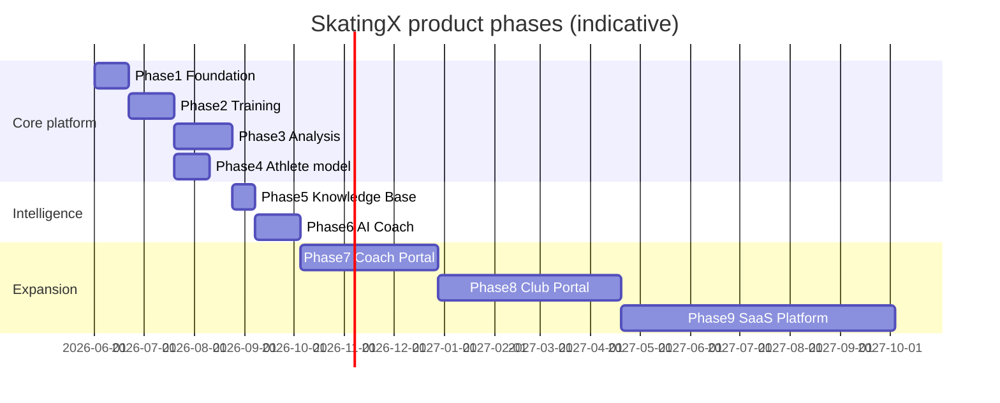
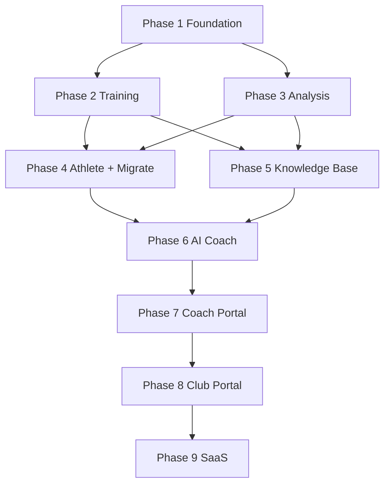

# SkatingX Product Roadmap

**Document:** Master product roadmap  
**Version:** 1.0  
**Date:** 2026-06-03  
**Status:** Planning — timelines are estimates; subject to [SKATINGX_OPEN_DECISIONS.md](./SKATINGX_OPEN_DECISIONS.md) approvals  
**Related:** [SKATINGX_ARCHITECTURE_BLUEPRINT.md](./SKATINGX_ARCHITECTURE_BLUEPRINT.md) · [merge-readiness-audit.md](./merge-readiness-audit.md)

**Legacy sources:** `blaze-skate-training` (BLAZE Training) · `blaze-skate-analysis` (BLAZE SKATE LAB)  
**Future platform:** **SKATINGX**

---

## Roadmap at a glance

| Phase | Name | Est. duration | Priority | Target window* |
|-------|------|---------------|----------|----------------|
| 1 | Foundation Platform | 3 weeks | P0 | Month 1 |
| 2 | Training Migration | 4 weeks | P0 | Month 2 |
| 3 | Analysis Migration | 5 weeks | P0 | Month 2–3 |
| 4 | Unified Athlete Model | 3 weeks | P0 | Month 3–4 |
| 5 | Knowledge Base | 2 weeks | P1 | Month 4 |
| 6 | AI Coach | 4 weeks | P1 | Month 5 |
| 7 | Coach Portal | 12 weeks | P2 | Month 6–9 |
| 8 | Club Portal | 16 weeks | P2 | Month 10–14 |
| 9 | SaaS Platform | 24+ weeks | P3 | Month 15+ |

\*Assumes ~1 full-time equivalent product engineering core; parallel roles (design, ops) not included.

---

# Product Vision

### North star

Build the **world’s best AI-powered short track speed skating training and analysis platform**—where daily habits, lab-grade insight, and trusted coaching guidance form one continuous loop for athletes, parents, coaches, and clubs.

### Mission (2026–2027)

Unify **BLAZE Training** and **BLAZE SKATE LAB** into **SkatingX**: one mobile-first web platform that helps youth short track skaters **train consistently**, **understand performance**, and **act on feedback**—with video analytics processed **on-device** by default and cloud data limited to what families and coaches actually need to share.

### Strategic outcomes

| Horizon | Outcome |
|---------|---------|
| **Year 1** | Single SkatingX app replaces legacy apps; parity + unified athlete; analysis tags on dashboard; optional AI Coach narrative |
| **Year 2** | Coach portal; roster and assignment workflows; richer reports |
| **Year 3+** | Club SaaS; billing; benchmarks; API ecosystem |

### What success looks like (product)

- A parent opens **one app** to see today’s tasks, streak, latest analysis insight, and next recommended drill.
- An athlete completes tasks, earns XP, and sees **why** yesterday’s pacing session changed this week’s plan.
- A coach reviews biomechanics tags and equipment history without maintaining a separate Lab URL.
- A club (later) manages many athletes with clear data boundaries and subscription value.

---

# Core Product Principles

| # | Principle | Product implication |
|---|-----------|-------------------|
| 1 | **Train → Analyze → Improve** | Every module should close the loop back to daily training—not standalone dashboards. |
| 2 | **Privacy-first video** | Video stays on device for pose analysis; marketing and UX must state this clearly. |
| 3 | **Athlete-centric data** | Siblings, teams, and history attach to `athleteId`, not one blob per login. |
| 4 | **Parent trust** | PIN, email recovery, transparent points, no surprise data loss on migrate. |
| 5 | **Coach credibility** | Heuristics and AI suggestions use explainable tags—not black-box scores. |
| 6 | **Progressive disclosure** | Mobile-simple daily path; depth (Lab, equipment) one tap away. |
| 7 | **Content as product** | Academy, Junior D plans, and symptom guides are versioned knowledge—not hardcoded afterthoughts. |
| 8 | **Earn the SaaS expansion** | Club and billing features only after single-family experience is excellent. |

---

# User Types

## Athlete

| Attribute | Detail |
|-----------|--------|
| **Who** | Youth short track skater (primary age bands: 4–6, 7–10, 11–16 per legacy Academy; Junior D for lab pacing) |
| **Jobs to be done** | Know what to do today; log effort; see progress; feel rewarded; understand technique gaps in kid-friendly language |
| **Primary modules** | Dashboard, Training (tasks, academy, shop), Analysis (bio, pacing—with parent/coach help), Athlete profile (view) |
| **MVP** | Full training loop; analysis consumption; limited AI Coach Q&A if enabled |
| **Later** | Self-serve session upload; social sharing; club team feed |

**Key pain today:** Training app has no analysis; Lab is not built for gamified daily habit.

---

## Parent

| Attribute | Detail |
|-----------|--------|
| **Who** | Guardian managing account, settings, rewards, and often multiple children |
| **Jobs to be done** | Set weekly rhythm; approve rewards; bind email for backup; control advanced settings; switch between athletes |
| **Primary modules** | Settings, Athlete management, Training (shop, templates), Dashboard |
| **MVP** | Email bind, parent PIN, multi-athlete switch (Phase 4), PRO flow |
| **Later** | Family billing; progress reports emailed; club invoices |

**Key pain today:** Two apps, two point balances, no sibling model.

---

## Coach

| Attribute | Detail |
|-----------|--------|
| **Who** | Private coach, parent-coach, or club coach reviewing technique and plans |
| **Jobs to be done** | Assign weekly focus; review pose/pacing/equipment; confirm plan check-ins; recommend adjustments |
| **Primary modules** | Analysis (all), Training plan, AI Coach, Reports (future), Coach Portal (Phase 7) |
| **MVP** | Embedded custom-token access; full analysis modules; planning check-in parity |
| **Later** | Roster, comments, assign tasks to athletes, org dashboards |

**Key pain today:** Lab tied to one athlete persona; no roster or assignment.

---

## Club

| Attribute | Detail |
|-----------|--------|
| **Who** | Club director, program lead, or business owner of a skating program |
| **Jobs to be done** | Onboard many athletes; standardize curriculum; monitor engagement; pay for seats |
| **Primary modules** | Club Portal (Phase 8), SaaS billing (Phase 9), Reports, Knowledge Base |
| **MVP** | Not in scope |
| **Later** | Org tenant, roles, roster import, club-branded content, aggregate analytics |

**Key pain today:** No multi-tenant product—only individual family accounts.

---

# Product Modules

High-level module map and legacy source.

| Module | Purpose | Legacy source | MVP? |
|--------|---------|---------------|------|
| **Dashboard** | Today at a glance | Training dashboard + Lab summary | Yes |
| **Training System** | Habit & curriculum | `blaze-skate-training` | Yes |
| **Analysis System** | Lab analytics | `blaze-skate-analysis` | Yes |
| **Athlete Profile** | Identity & division | Training username + Lab Lindsay profile | Yes |
| **AI Coach** | Actionable guidance | New | Partial |
| **Knowledge Base** | Curated content | Academy + plansDatabase + symptoms | Partial |
| **Reports** | Export & share | New | No |

---

## Dashboard

**Purpose:** Single home for motivation and cross-module insight.

| Capability | Description | Phase |
|------------|-------------|-------|
| Today’s training summary | Tasks open/done, weekly template label | 2 |
| Streak & points | From gamification | 2 |
| Next race countdown | From races | 2 |
| Latest analysis tags | From recent sessions | 4–6 |
| AI recommendation teaser | Link to `/ai-coach` | 6 |
| Athlete switcher | Header context | 4 |

**Business impact:** Increases DAU and cross-sell between training and analysis—core differentiator vs split BLAZE apps.

---

## Training System

Unified gamified training from BLAZE Training.

### Daily Tasks

| Capability | Legacy | Phase |
|------------|--------|-------|
| Add / edit / complete tasks | `tasks[]` | 2 |
| Points per task | `pointsPerTask` | 2 |
| All-done daily bonus | `dailyBonusPoints`, `completedDays` | 2 |
| Cross-day rollover & history | `taskHistory` | 2 |

### Streak

| Capability | Legacy | Phase |
|------------|--------|-------|
| Consecutive completed days | `completedDays` streak calc | 2 |
| Calendar history view | History modal | 2 |

### XP

| Capability | Legacy | Phase |
|------------|--------|-------|
| Points balance | `points` → `gamification/main` | 2 + 4 migrate |
| Manual parent adjustment | Settings | 2 |

*Product note: “XP” = points currency; keep familiar language in UI.*

### Rewards

| Capability | Legacy | Phase |
|------------|--------|-------|
| Shop redemption | `customRewards`, `rewardHistory` | 2 |
| Custom rewards (PRO) | Shop item modal | 2 |
| Celebration UX | Redemption overlay | 2 |

### Academy

| Capability | Legacy | Phase |
|------------|--------|-------|
| Age-band curriculum zh/en | `BLAZE_ACADEMY` | 2 |
| PRO import routine → tasks | `importAcademyRoutine` | 2 |
| Weekly dryland plans per stage | Embedded in Academy | 5 (KB structure) |

**Business impact:** Retains existing Training users; habit loop drives retention.

---

## Analysis System

Unified lab from BLAZE SKATE LAB.

### Video Analysis

| Capability | Legacy | Phase |
|------------|--------|-------|
| Local file upload | `URL.createObjectURL` | 3 |
| Playback & scrubber | Video controls | 3 |
| Privacy messaging | UI copy | 3 |
| No cloud video storage | Policy | 3 |

### Biomechanics

| Capability | Legacy | Phase |
|------------|--------|-------|
| MediaPipe pose overlay | Biomechanics tab | 3 |
| Support leg scoring & HUD | Heuristics | 3 |
| Keyframes (max 10, session) | `keyframeSamples` | 3 |
| Session summary persist | **New** | 4–6 |

### Pacing Analysis

| Capability | Legacy | Phase |
|------------|--------|-------|
| 500m / 777m / 1000m Junior D | Pacing tab | 3 |
| Lactic decay index & narrative | Heuristic | 3 |
| Chart.js curves | Pacing charts | 3 |
| Optional save to PB records | Not in legacy | 13 (DR-013) |

### Equipment Analysis

| Capability | Legacy | Phase |
|------------|--------|-------|
| Symptom templates | slide, bootout, etc. | 3 |
| Rocker / offset / bend forms | Equipment tab | 3 |
| Rule hints & report | `buildEquipmentRuleHints` | 3 |
| History & A/B compare | Cloud + local fallback | 3 |
| Link to biomechanics复查 | Cross-tab | 3 |

**Planning (related):** Junior D weekly plan check-in (`plansDatabase`) ships with Training route `/training/plan` in Phase 2–3.

**Business impact:** Differentiated technical product; keeps coach/parent-coach audience from Lab.

---

## Athlete Profile

| Capability | Phase | Notes |
|------------|-------|-------|
| Display name, avatar | 4 | Storage URL not data URL |
| Birth date & US division badge | 4 | From Lab logic |
| Multiple athletes per account | 4 | **DR-003** |
| `activeAthleteId` | 4 | **DR-014** |
| Edit profile / add athlete | 4 | `/athlete` routes |

**Business impact:** Enables families and future club roster model.

---

## AI Coach

| Layer | User-facing value | Phase |
|-------|-------------------|-------|
| **L1 Tags** | “Late decay high”, “left support weak” on dashboard | 6 |
| **L3 Apply** | One tap add tasks from recommendation | 6 |
| **L2 Narrative** | Conversational coach (optional MVP) | 6 — **DR-005** |

**Business impact:** Long-term moat vs generic fitness apps; must stay explainable and safe for minors.

---

## Knowledge Base

| Content type | Legacy source | Phase |
|--------------|---------------|-------|
| BLAZE Academy stages | Training | 5 |
| Junior D plan focuses (lean/bounce/endurance) | Analysis | 5 |
| Equipment symptom guides | Analysis | 5 |
| Browse UI `/knowledge` | New | 5 |
| Future articles & video metadata | New | 7+ |

**Business impact:** Reduces engineering cost for curriculum updates; foundation for club-custom content.

---

## Reports

| Capability | Phase | Audience |
|------------|-------|----------|
| Session PDF (client-generated) | Post-MVP | Parent, coach |
| Weekly progress email | Phase 7+ | Parent |
| Club aggregate dashboard | Phase 8–9 | Club |

**Business impact:** Coach and club willingness to pay; not required for first beta.

---

# Development Phases

Each phase includes **dependencies**, **priority**, **business impact**, and **exit criteria**.

---

## Phase 1 – Foundation Platform

| Field | Value |
|-------|--------|
| **Est. timeline** | 3 weeks |
| **Priority** | P0 — blocking all product work |
| **Dependencies** | Approve DR-001, DR-006, DR-009, DR-010, DR-015 (see OPEN_DECISIONS) |
| **Business impact** | De-risks delivery; enables investor/stakeholder demo of unified shell; stops split-stack tax |

### Deliverables

- `skatingx-platform` monorepo initialized
- `apps/web`: React 19, Vite, React Router, Tailwind, i18n shell
- Routes stubbed: `/dashboard`, `/training`, `/analysis`, `/settings`, `/athlete`
- Firebase Auth: anonymous + email link + custom token hooks
- `packages/firebase-client`, `packages/schema` (paths only)
- `firebase/firestore.rules` deployed to chosen project
- CI: lint, build, preview deploy
- Staging environment

### Exit criteria

- New user can sign in anonymously and navigate all stub routes
- Firestore write/read smoke test under `artifacts/skatingx-production/`

### Risks if delayed

- Parallel Training/Analysis ports blocked; migration scripts lack target project

---

## Phase 2 – Training Migration

| Field | Value |
|-------|--------|
| **Est. timeline** | 4 weeks |
| **Priority** | P0 |
| **Dependencies** | Phase 1; schema package; DR-011 (PIN) before prod PIN storage |
| **Business impact** | Protects existing Training user base; first shippable product value |

### Deliverables

- **Dashboard** (core widgets)
- **Training System:** Daily Tasks, Streak, XP, Rewards, Academy (PRO import)
- **Weekly template** & race targets in settings
- **Training plan** route: Junior D `plansDatabase` UI + check-in (transactional) — may share backend with Phase 3
- Auth: email bind, logout, guest mode
- Settings: language, themes, PRO showcase (per DR-012)
- Feature parity checklist vs `blaze-skate-training` audit §5

### Exit criteria

- Side-by-side UAT: 10 core Training flows pass on staging
- Firestore writes use athlete + settings split (prep for Phase 4 migrate)

### Business impact detail

| Stakeholder | Value |
|-------------|-------|
| Parent / athlete | No regression vs BLAZE Training |
| Business | Can beta with training-only cohort while Analysis in Phase 3 |

---

## Phase 3 – Analysis Migration

| Field | Value |
|-------|--------|
| **Est. timeline** | 5 weeks |
| **Priority** | P0 |
| **Dependencies** | Phase 1; Phase 2 gamification repo (shared points tx); MediaPipe bundle strategy |
| **Business impact** | Completes “lab in pocket”; primary technical differentiation |

### Deliverables

- **Video Analysis** + **Biomechanics** (lazy route chunk)
- **Pacing Analysis** with Chart.js
- **Equipment Analysis** with cloud history (fix `createdAt`/`savedAt`)
- Analysis layout (dark/light)
- Custom token embed path for coaches
- Feature parity vs `blaze-skate-analysis` audit §5

### Exit criteria

- MediaPipe works on target mobile browsers (test matrix documented)
- Equipment cloud sort correct; plan check-in idempotent
- Privacy copy reviewed

### Business impact detail

| Stakeholder | Value |
|-------------|-------|
| Coach | One URL for lab tools |
| Athlete / parent | Analysis adjacent to training in same app |

---

## Phase 4 – Unified Athlete Model

| Field | Value |
|-------|--------|
| **Est. timeline** | 3 weeks (can overlap final week of Phase 3) |
| **Priority** | P0 for production cutover |
| **Dependencies** | Phases 2–3 feature-complete on staging; **DR-003, DR-004, DR-007, DR-014** approved |
| **Business impact** | Trust at migrate; enables siblings and correct points story |

### Deliverables

- Multi-athlete CRUD (`/athlete`, `/athlete/:id`)
- `activeAthleteId` in settings + header switcher
- Migration scripts: Training blob → split docs; Analysis → `athletes/lindsay`
- Production cutover runbook + legacy read-only banners
- Dashboard shows per-athlete context
- Avatar via Storage
- Points verification (DR-004 alignment table)

### Exit criteria

- Migrate dry-run on prod export: &lt;1% doc anomalies
- E2E: parent with two athletes switches context without data bleed
- Legacy apps redirect to SkatingX

### Business impact detail

| Stakeholder | Value |
|-------------|-------|
| Parent | One login, multiple skaters |
| Business | **First public beta** gate (see MVP) |

---

## Phase 5 – Knowledge Base

| Field | Value |
|-------|--------|
| **Est. timeline** | 2 weeks |
| **Priority** | P1 |
| **Dependencies** | Phase 2 Academy + Phase 3 plans content extracted to `packages/content` |
| **Business impact** | Faster content updates; professional positioning vs “hardcoded app” |

### Deliverables

- `packages/content`: `academy.json`, `plans-junior-d.json`, `symptoms.json` with `contentVersion`
- `/knowledge` browse and article views
- Academy and plan UIs read from content package
- Editorial workflow doc (how to bump version)

### Exit criteria

- Content change without app redeploy (or single config deploy)
- zh/en keys validated for Academy strings

### Business impact

| Stakeholder | Value |
|-------------|-------|
| Coach | Clear reference material for parents |
| Ops | Non-engineers can plan content pipeline |

---

## Phase 6 – AI Coach

| Field | Value |
|-------|--------|
| **Est. timeline** | 4 weeks |
| **Priority** | P1 (P0 for “AI-powered” marketing if promised at launch) |
| **Dependencies** | Phase 4–5; analysis session persistence; **DR-005** |
| **Business impact** | Delivers north-star narrative; retention via personalized plans |

### Deliverables

- L1: `analysisTag` generation from bio, pacing, equipment
- Persist `analysis/sessions/{id}/summary`
- Dashboard tag feed
- L3: `coach/recommendations` + “Apply to today’s tasks”
- `/ai-coach` UI
- L2 (optional): Callable LLM + quotas per DR-005

### Exit criteria

- Tag → recommendation → applied task traceable in Firestore
- Safety review: no medical claims; no video to LLM
- PRO/free quota behavior defined

### Business impact

| Stakeholder | Value |
|-------------|-------|
| Athlete / parent | Understand *why* plan changed |
| Business | Defensible AI story vs competitors |

---

## Phase 7 – Coach Portal

| Field | Value |
|-------|--------|
| **Est. timeline** | 12 weeks |
| **Priority** | P2 |
| **Dependencies** | Phases 1–6 stable; org model design; Reports MVP |
| **Business impact** | B2B2C revenue path; coach retention and referrals |

### Deliverables (indicative)

- Coach account type or org-linked coach role
- Roster: invite athletes by code or parent approval
- Assign weekly plan focus to athlete
- Comment on analysis sessions
- Coach dashboard: engagement, tags, overdue tasks
- Bulk export / PDF report per athlete
- Optional: read-only parent share link

### Exit criteria

- Pilot with 3–5 coaches, 20+ athletes
- Coach NPS survey ≥ target (define pre-pilot)

### Business impact

| Metric | Expected direction |
|--------|-------------------|
| CAC | Lower via coach-led onboarding |
| Retention | Higher when coach assigns work |
| ARPU | Coach-tier subscription (pre-Phase 9) |

---

## Phase 8 – Club Portal

| Field | Value |
|-------|--------|
| **Est. timeline** | 16 weeks |
| **Priority** | P2 |
| **Dependencies** | Phase 7 coach primitives; org schema; billing design |
| **Business impact** | Scalable revenue; “club management” market entry |

### Deliverables (indicative)

- Organization tenant (`orgs/{orgId}`)
- Club admin roles (admin, coach, read-only)
- Roster import (CSV)
- Club-branded Knowledge Base overrides
- Aggregate analytics: attendance, points, analysis tag prevalence
- Club-level plan templates
- Compliance: parent consent for minors

### Exit criteria

- One pilot club (30–100 athletes) on production org
- Support playbooks for admin onboarding

### Business impact

| Metric | Expected direction |
|--------|-------------------|
| ARR | Primary B2B driver |
| Churn | Lower at org level vs individual |

---

## Phase 9 – SaaS Platform

| Field | Value |
|-------|--------|
| **Est. timeline** | 24+ weeks (ongoing) |
| **Priority** | P3 |
| **Dependencies** | Phases 7–8; payment provider choice (DR-012 extension) |
| **Business impact** | Full platform business; international scale |

### Deliverables (indicative)

- Stripe (or regional) billing: family PRO, coach seat, club tier
- Self-serve signup & trial
- Usage metering (AI Coach L2 calls, storage)
- Public API read-only for partners
- Opt-in anonymized benchmarks (“Junior D pacing cohort”)
- White-label / regional partnerships
- Mobile native wrappers (if PWA insufficient)
- Compliance: GDPR, COPPA-style parental flows

### Exit criteria

- SaaS metrics dashboard live (MRR, churn, LTV)
- 10+ paying clubs or equivalent ARR milestone

### Business impact

Positions SkatingX as **category leader** infrastructure—not a single-team app.

---

# MVP Definition

**First public beta** = families can replace BLAZE Training + BLAZE SKATE LAB for daily use without data loss.

### MVP scope (must ship)

| Area | Included |
|------|----------|
| Phases | **1 + 2 + 3 + 4** (complete) |
| Dashboard | Yes — tasks, streak, points, races, basic tags placeholder OK until Phase 6 |
| Training | Tasks, streak, XP, rewards, academy, shop, settings, email auth, parent PIN |
| Analysis | Biomechanics, pacing, equipment, planning check-in |
| Athlete | Multi-athlete + migrate legacy data |
| Knowledge Base | **Minimum:** content in package; browse can be **post-beta** if Academy/plan in-app unchanged |
| AI Coach | **Minimum:** L1 tags on dashboard **or** defer to fast-follow within 4 weeks post-beta |
| Coach Portal | **No** |
| Club Portal | **No** |
| Reports PDF | **No** |
| SaaS billing | **No** — manual PRO acceptable (DR-012 A) |

### MVP timeline (critical path)

| Milestone | Est. cumulative |
|-----------|-----------------|
| Decisions approved (DR-001, 003, 004, 006, 007) | Week 0–2 |
| Phase 1 complete | Week 3 |
| Phase 2 complete | Week 7 |
| Phase 3 complete | Week 12 |
| Phase 4 migrate + beta launch | Week 15 |

**~15 weeks** from kickoff with one strong full-stack engineer; add 3–5 weeks for part-time or unknowns.

### MVP explicitly out of scope

- Club orgs, coach roster, Stripe, LLM coach (unless DR-005 forces in), native apps, video cloud storage, social network, offline video analysis without network for CDN assets.

### Beta success criteria (launch gate)

| # | Criterion |
|---|-----------|
| 1 | 95% of migrated users retain correct points (DR-004 verified sample) |
| 2 | Training parity sign-off (10 flows) |
| 3 | Analysis parity sign-off (8 flows) |
| 4 | No P0 security issue (rules, PIN hash, auth domains) |
| 5 | Median Lighthouse performance acceptable on mid-range phone |
| 6 | Support docs + known issues list published |

---

# Success Metrics

### North star metric

**Weekly Active Athlete Sessions (WAAS):** count of athletes with ≥1 completed task or ≥1 analysis session per week.

### Phase-aligned KPIs

| Phase | Primary metrics | Secondary metrics |
|-------|-----------------|-------------------|
| 1–4 (MVP) | WAAS; task completion rate; migrate retention | Crash-free sessions; Firestore error rate |
| 5 | Content page views; academy import rate | Content version deploy frequency |
| 6 | Recommendation apply rate; tags per session | LLM cost per active user |
| 7 | Coaches onboarded; athletes per coach | Coach-assigned task completion |
| 8 | Clubs onboarded; seats active | Org-level WAAS |
| 9 | MRR; net revenue retention | CAC payback; API partner count |

### Product health metrics (ongoing)

| Metric | Target direction |
|--------|----------------|
| D1 / D7 retention (athlete) | Up vs legacy Training |
| Cross-module usage (% using train + analyze same week) | Up vs two-app baseline |
| Time to first analysis session (new users) | Down with unified onboarding |
| Parent email bind rate | Up (data safety) |
| NPS (parent) | ≥ legacy baseline at beta +30 days |

### Technical SLOs (product-facing)

| SLO | MVP target |
|-----|------------|
| App shell load (excl. MediaPipe) | &lt; 3s P75 mobile |
| Firestore sync after task complete | &lt; 2s perceived |
| MediaPipe session start | &lt; 10s model ready P75 |

---

# Risks

| ID | Risk | Likelihood | Impact | Mitigation | Phase |
|----|------|------------|--------|------------|-------|
| R1 | Open decisions delay kickoff | High | High | Weekly decision review; Phase 0 gate | Pre-1 |
| R2 | Migration points dispute | Medium | High | DR-004 manual table; communication plan | 4 |
| R3 | MediaPipe mobile failure | Medium | High | Device matrix; graceful degrade message | 3 |
| R4 | Scope creep (AI, club early) | High | Medium | MVP definition locked; fast-follow backlog | 6–9 |
| R5 | Single-engineer bus factor | Medium | High | Document; modular packages; hire/contract | All |
| R6 | Brand confusion BLAZE → SkatingX | Medium | Medium | DR-006; in-app transition copy | 4 |
| R7 | LLM cost / safety for minors | Medium | High | DR-005; L3 without L2 first | 6 |
| R8 | Coach portal demands custom workflows | High | Medium | Pilot coaches before build; Phase 7 discovery | 7 |
| R9 | Club compliance (minors, data) | Medium | High | Legal review before Phase 8 | 8 |
| R10 | Competitor or US Speedskating tooling | Low | Medium | Focus privacy + short track specificity | Ongoing |

---

# Future Opportunities

| Opportunity | Description | Earliest phase | Business upside |
|-------------|-------------|----------------|-----------------|
| **Long-track & inline** | Extend analysis to long track | Post-9 | Market expansion |
| **Wearables / HR integration** | Import HR for pacing sessions | 7+ | Premium feature |
| **Live practice mode** | Real-time audio cues on ice | 6+ | Coach stickiness |
| **Team relay analytics** | Exchange detection, pushes | 8+ | National team B2B |
| **Video cloud (opt-in)** | Coach-reviewed upload with consent | 7+ | Higher ARPU |
| **Marketplace** | Third-party lesson packs | 9+ | Platform take rate |
| **Localized clubs (EU/KR/CN)** | i18n + regional benchmarks | 9+ | Global TAM |
| **AI video summarization** | On-device clip highlights | 6+ | Viral sharing |
| **Integration ISU / federation** | Official benchmark data feeds | 9+ | Authority & PR |
| **SkatingX API ecosystem** | Timing gates, video platforms | 9+ | Platform moat |

---

## Roadmap dependency graph

---

## Document governance

| Action | Owner |
|--------|-------|
| Approve phase scope change | Product lead |
| Move MVP boundary | Product + engineering lead |
| Update timelines | Engineering lead (monthly) |
| Link decision | [SKATINGX_OPEN_DECISIONS.md](./SKATINGX_OPEN_DECISIONS.md) |

### Related documents

| Document | Role |
|----------|------|
| [SKATINGX_ARCHITECTURE_BLUEPRINT.md](./SKATINGX_ARCHITECTURE_BLUEPRINT.md) | Technical target state |
| [merge-readiness-audit.md](./merge-readiness-audit.md) | Legacy comparison |
| [SKATINGX_OPEN_DECISIONS.md](./SKATINGX_OPEN_DECISIONS.md) | Blocking decisions |

---

## Revision history

| Version | Date | Changes |
|---------|------|---------|
| 1.0 | 2026-06-03 | Initial master product roadmap |

---

*Path: `skatingx-platform/docs/PRODUCT_ROADMAP.md`*
