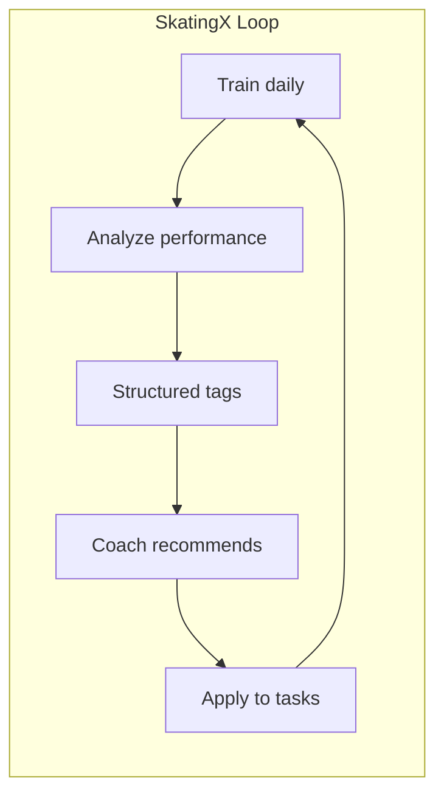
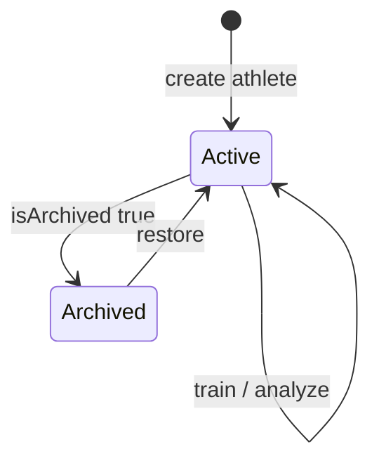
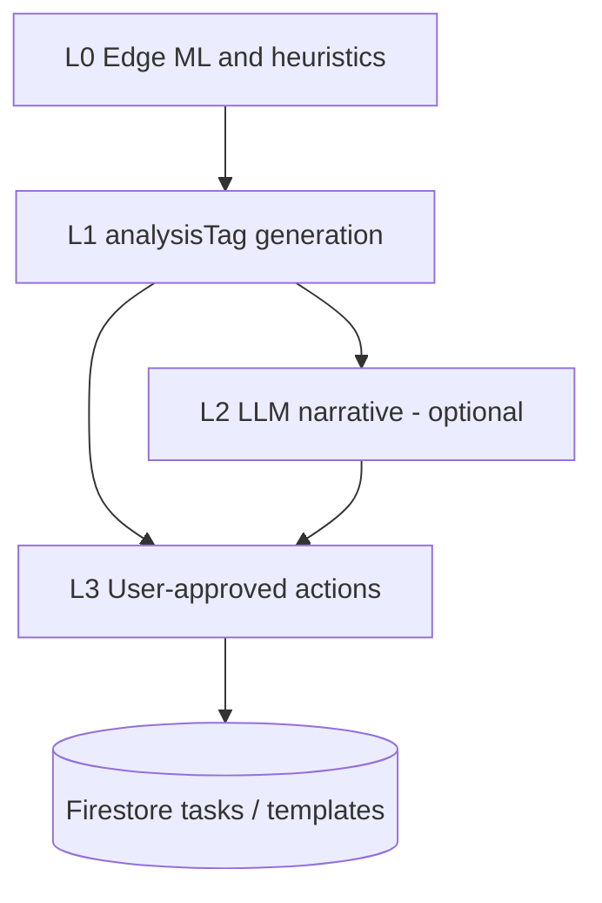
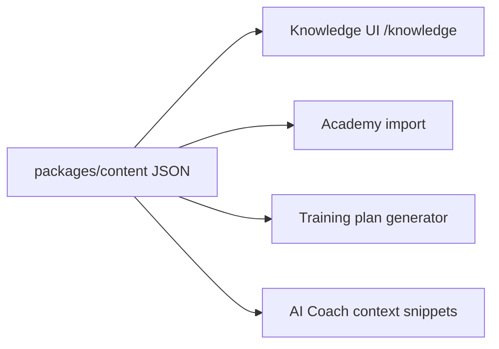
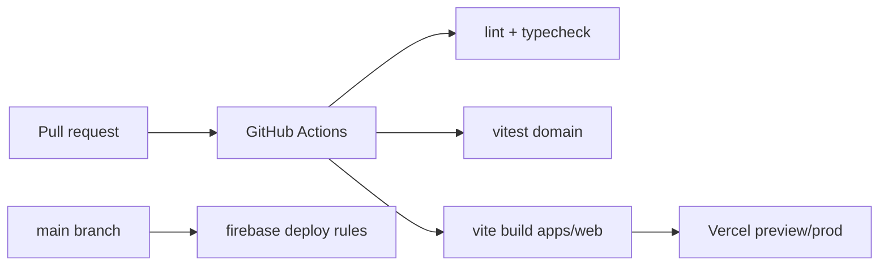
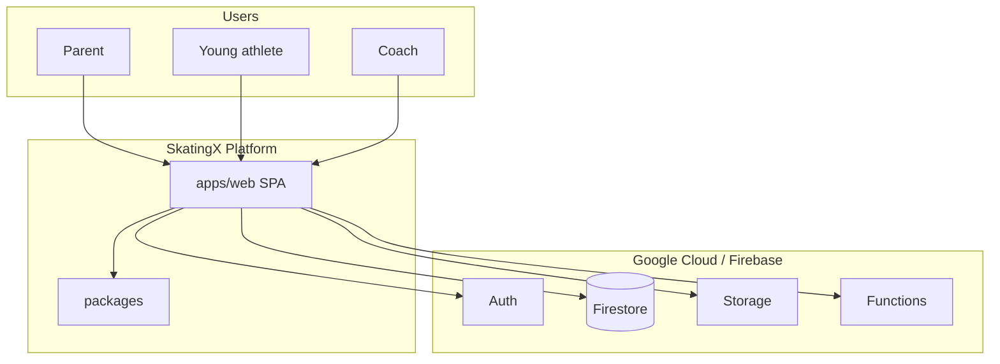

# SkatingX Platform — Architecture Blueprint

**Version:** 2.0  
**Date:** 2026-06-03  
**Status:** Target-state architecture (pre-implementation)  
**Sources:**

- [blaze-skate-training/docs/architecture-audit.md](../../blaze-skate-training/docs/architecture-audit.md)
- [blaze-skate-analysis/docs/architecture-audit.md](../../blaze-skate-analysis/docs/architecture-audit.md)
- [merge-readiness-audit.md](./merge-readiness-audit.md)
- [SKATINGX_OPEN_DECISIONS.md](./SKATINGX_OPEN_DECISIONS.md)

**Scope:** Architecture and product design only. No implementation code.

---

## Document purpose

This blueprint defines the **unified SkatingX platform** that subsumes **BLAZE Training** (`blaze-skate-training`) and **BLAZE SKATE LAB** (`blaze-skate-analysis`) into a single product: one SPA, one Firebase topology, one athlete-centric data model, and a path toward coach tooling and SaaS.

Legacy apps remain the **source of truth for domain behavior** until migration cutover; this document is the **target** they converge on.

---

## Platform constants

| Constant | Value | Notes |
|----------|--------|--------|
| `PLATFORM_APP_ID` | `skatingx-production` | Firestore namespace under `artifacts/` |
| `LEGACY_TRAINING_APP_ID` | `blaze-skate-production` | Migration source |
| `LEGACY_ANALYSIS_APP_ID` | `blaze-skate-academy` | Migration source |
| `DEFAULT_ATHLETE_ID` | `default` | Placeholder when no named athlete exists post-migrate |

---

## 1. Product Vision

### Mission

**SkatingX** is a speed-skating performance platform for young athletes and their families that connects **daily training habits**, **structured curriculum**, **quantitative analysis** (pose, pacing, equipment), and **actionable coaching**—without uploading training video to the cloud by default.

### Problem today (legacy split)

| Legacy app | Solves | Gap |
|------------|--------|-----|
| **blaze-skate-training** | Habit, tasks, academy, PB records, points shop, parent/PRO | No lab analysis, no coach-grade tooling |
| **blaze-skate-analysis** | Biomechanics, Junior D pacing, weekly plans, equipment history | Single-athlete hard-code (Lindsay), no family training loop, separate Firebase tree |

Families use Training; a coach/serious athlete uses Lab. Data and points do not cross over.

### SkatingX promise

1. **One account, many athletes** — siblings and profiles under one parent `userId`.
2. **One points and progress story** — gamification tied to `athleteId`, not duplicate profile docs.
3. **Analysis informs training** — biomechanics, pacing, and equipment produce **analysis tags** that surface on the dashboard and drive **AI Coach** recommendations users can apply to today’s tasks.
4. **Privacy by design** — pose and video processing stay in the browser; cloud stores summaries, tags, and structured metrics only.
5. **BLAZE brand continuity** — evolve “冰焰速滑 / BLAZE SKATE” into SkatingX while preserving proven UX patterns from both apps.

### Success metrics (architecture-enabling)

| Metric | Implication |
|--------|-------------|
| Single deployable web app | `skatingx-platform/apps/web` |
| < 2s initial route (excl. MediaPipe chunk) | Code-split analysis |
| Firestore doc size safe | No avatar blobs; split documents |
| Coach can embed Lab | Custom token auth preserved |
| Curriculum versioned | Knowledge Base module with `contentVersion` |



---

## 2. User Types

### Primary personas

| Persona | Description | Primary surfaces | Legacy origin |
|---------|-------------|------------------|---------------|
| **Young athlete** | Skater using app for tasks and rewards | `/training`, `/dashboard` | Training |
| **Parent / guardian** | Manages settings, PIN, PRO, multiple athletes | `/settings`, `/athlete` | Training |
| **Coach (parent-coach)** | Reviews analysis, plans, equipment | `/analysis`, `/training/plan` | Analysis |
| **Guest skater** | Anonymous Firebase user before email bind | All (limited persistence messaging) | Both |

### Secondary personas (near-term)

| Persona | Description | Auth | Surfaces |
|---------|-------------|------|----------|
| **Embedded coach** | External tool or iframe with custom token | `signInWithCustomToken` | `/analysis/*` |
| **Club admin** | Future: roster, billing | Custom claims / org id | SaaS (§13) |

### Permissions model (MVP)

| Capability | Guest | Registered parent | PRO (`isPro`) | Coach token |
|------------|-------|-------------------|---------------|-------------|
| Read/write own `userId` data | Yes | Yes | Yes | Yes (that uid) |
| Email bind | — | Yes | Yes | — |
| Parent PIN gated settings | — | Yes | Yes (PIN required) | — |
| Academy import to tasks | — | — | Yes | — |
| Custom shop rewards | — | — | Yes | — |
| AI Coach L2 (LLM) | Limited | Limited | Higher quota | TBD |

**Not in MVP:** multi-tenant org admin, role-based coach access to arbitrary athletes (requires org schema in §13).

### Language

| Locale | MVP | Source |
|--------|-----|--------|
| `zh` | Full | Training `translations` + Analysis copy |
| `en` | Full for Training surfaces; Analysis strings phased in | Training |

---

## 3. Athlete Model

### Concepts

| Term | Definition |
|------|------------|
| **userId** | Firebase Auth UID — typically parent account |
| **athleteId** | Stable key for all sport data under that account |
| **activeAthleteId** | Which athlete the UI reads/writes by default |

### athleteId format

| Rule | Specification |
|------|----------------|
| Pattern | `[a-z0-9][a-z0-9-_]{1,63}` |
| New athletes | Prefer `uuid` or `slug-{shortId}` |
| Migration | Allow `default`, `lindsay` as legacy ids |

### Athlete document responsibilities

Each `athletes/{athleteId}` owns:

- Profile (name, birthDate, division cache, avatar Storage path)
- Gamification (points — **single source of truth per athlete**)
- Training state (tasks, templates, records, races, shop)
- Planning check-ins (Junior D plan tasks)
- Equipment history
- Analysis sessions and tags
- Coach recommendations

### Account vs athlete settings

| Data | Location |
|------|----------|
| `language`, `theme`, `parentPin`, `isPro`, `activeAthleteId` | `users/{userId}/settings/main` |
| Sport-specific data | `users/{userId}/athletes/{athleteId}/...` |

### Legacy mapping

| Legacy | SkatingX athlete |
|--------|------------------|
| Training `profile/main` (no athlete concept) | `athletes/default` |
| Analysis `profile/lindsay` | `athletes/lindsay` |
| Same uid in both apps | Up to **DR-003** (merge vs dual athlete) |

### Division calculation

Reuse Analysis logic: US speedskating season age from `birthDate` → cached `skatingDivision` on `profile/main` (e.g. Junior D). Shown on dashboard and athlete card.

### Lifecycle



---

## 4. Firebase Architecture

### Services (production)

| Service | Role | MVP |
|---------|------|-----|
| **Firebase Authentication** | Anonymous, email/password link, custom token | Yes |
| **Cloud Firestore** | Primary database | Yes |
| **Cloud Storage** | Athlete avatars only | Yes |
| **Cloud Functions** | AI Coach L2 Callable (optional MVP) | Phase 2 |
| **Firebase Hosting** | Optional mirror; primary deploy Vercel | Vercel preferred |
| **Analytics / FCM** | Product analytics, push | Future |

**Not used:** Realtime Database, Firebase ML, default video Storage.

### Project topology

| Layer | Decision |
|-------|----------|
| **GCP projects** | **One production project** (see DR-001 in OPEN_DECISIONS) |
| **Environments** | `dev`, `staging`, `production` — separate Firebase projects or named databases |
| **App namespace** | `artifacts/skatingx-production/...` only for new writes post-cutover |

### Client SDK

| Aspect | Target |
|--------|--------|
| Package | `firebase` ^12.x via npm in `packages/firebase-client` |
| Init | `VITE_FIREBASE_*` at build time (Analysis pattern, not Training hardcode) |
| Offline | `enableIndexedDbPersistence` for all routes (Training pattern) |
| Embeds | Support `__initial_auth_token`, `__app_id` overrides for sandbox only |

### Security rules (summary)

```text
match /artifacts/{appId}/users/{userId}/{document=**} {
  allow read, write: if request.auth != null
    && request.auth.uid == userId
    && appId == 'skatingx-production';
}
```

**Hardening backlog:** hash or server-gate `isPro`; restrict who can set `parentPin`; optional field-level validation via Functions.

### Storage layout

```text
users/{userId}/athletes/{athleteId}/avatar.jpg
```

### Environment variables

| Variable | Used by |
|----------|---------|
| `VITE_FIREBASE_API_KEY` | `apps/web` build |
| `VITE_FIREBASE_AUTH_DOMAIN` | |
| `VITE_FIREBASE_PROJECT_ID` | |
| `VITE_FIREBASE_STORAGE_BUCKET` | |
| `VITE_FIREBASE_MESSAGING_SENDER_ID` | |
| `VITE_FIREBASE_APP_ID` | |
| `VITE_PLATFORM_APP_ID` | Default `skatingx-production` |
| `AI_COACH_*` | Functions only (never client bundle) |

---

## 5. Firestore Schema

### Tree overview

```text
artifacts/skatingx-production/users/{userId}/
├── settings/main
├── athletes/{athleteId}/
│   ├── profile/main
│   ├── gamification/main
│   ├── training/
│   │   ├── state/main
│   │   ├── taskHistory/{dateId}          # YYYY-MM-DD
│   │   ├── records/{distanceId}
│   │   ├── races/{raceId}
│   │   ├── rewards/catalog
│   │   └── redemptions/{redemptionId}
│   ├── planning/completedTasks/{taskId}
│   ├── equipment/records/{recordId}
│   ├── analysis/
│   │   ├── sessions/{sessionId}/summary
│   │   └── tags/{tagId}                  # optional index
│   └── coach/
│       ├── recommendations/{recId}
│       └── threads/{threadId}            # optional L2 chat
└── meta/migration
```

### Key documents

#### `settings/main`

| Field | Type | Notes |
|-------|------|-------|
| `activeAthleteId` | string | Required |
| `language` | `zh` \| `en` | |
| `theme` | string | Global shell preference |
| `parentPinHash` | string | Replace plaintext PIN from Training |
| `isPro` | boolean | Manual or future billing |
| `createdAt`, `updatedAt` | timestamp | |

#### `athletes/{id}/profile/main`

| Field | Type | Notes |
|-------|------|-------|
| `displayName` | string | |
| `birthDate` | string | ISO date |
| `skatingDivision` | string | Cached |
| `avatarStoragePath` | string | |
| `legacySource` | object | Migration audit |

#### `athletes/{id}/gamification/main`

| Field | Type | Notes |
|-------|------|-------|
| `points` | number | **Canonical** balance |
| `pointsPerTask`, `dailyBonusPoints` | number | From Training |
| `completedDays` | string[] | Streak dates |

#### `athletes/{id}/training/state/main`

| Field | Type | Notes |
|-------|------|-------|
| `lastLoginDate` | string | Cross-day rollover |
| `weeklyTemplate` | map 0–6 | Day labels |
| `tasks` | Task[] | Today’s list |

#### `athletes/{id}/planning/completedTasks/{taskId}`

| Field | Type | Notes |
|-------|------|-------|
| `taskId` | string | e.g. `jd_tech_mon` |
| `planFocus` | string | `lean` \| `bounce` \| `endurance` |
| `pointsAwarded` | number | |
| `completedAt` | timestamp | Transactional idempotency |

#### `athletes/{id}/equipment/records/{recordId}`

Full equipment snapshot from Lab; **must** set both `savedAt` and `createdAt` (fix legacy bug).

#### `athletes/{id}/analysis/sessions/{sessionId}/summary`

| Field | Type | Notes |
|-------|------|-------|
| `module` | enum | biomechanics, pacing, equipment |
| `status` | enum | draft, completed, discarded |
| `tags` | AnalysisTag[] | See §9 |
| `scores` | object | Raw metrics |
| `narrativeSummary` | string | Optional |
| `source` | object | `{ videoLocal: true }` |

### Indexes (required)

| Collection path | Fields |
|-----------------|--------|
| `equipment/records` | `createdAt` DESC |
| `analysis/sessions` | `completedAt` DESC |
| `coach/recommendations` | `status`, `createdAt` |
| `planning/completedTasks` | `completedAt` DESC (optional) |

### Write patterns

| Operation | Pattern |
|-----------|---------|
| Task toggle points | Client update `gamification` + `training/state` (Training parity) |
| Plan check-in | `runTransaction` on `completedTasks` + `increment` points (Analysis parity) |
| Equipment save | `addDoc` with timestamps |
| Avatar | Upload Storage → update `profile.avatarStoragePath` |

---

## 6. Routing Structure

### Router

**React Router 7** in `apps/web` — browser history API, deep links enabled.

### Route map

| Path | Module | Layout | Legacy |
|------|--------|--------|--------|
| `/` | Redirect → `/dashboard` | — | — |
| `/dashboard` | Dashboard | AppShell | Training dashboard + Lab summary |
| `/training` | Training home | TrainingLayout | tasks index |
| `/training/tasks` | Tasks + history | TrainingLayout | TasksView |
| `/training/academy` | BLAZE Academy | TrainingLayout | AcademyView |
| `/training/records` | PB records | TrainingLayout | DataView |
| `/training/records/:distance` | Distance detail | TrainingLayout | DataView |
| `/training/shop` | Points shop | TrainingLayout | ShopView |
| `/training/plan` | Junior D weekly plan | TrainingLayout | Analysis planning |
| `/analysis` | Analysis hub | AnalysisLayout | — |
| `/analysis/biomechanics` | MediaPipe lab | AnalysisLayout | biomechanics tab |
| `/analysis/pacing` | Pacing charts | AnalysisLayout | pacing tab |
| `/analysis/equipment` | Equipment | AnalysisLayout | equipment tab |
| `/analysis/sessions` | Session history | AnalysisLayout | **new** |
| `/analysis/sessions/:sessionId` | Session detail | AnalysisLayout | **new** |
| `/athlete` | Athlete list | AppShell | **new** |
| `/athlete/new` | Create athlete | AppShell | **new** |
| `/athlete/:athleteId` | Edit profile | AppShell | lindsay profile |
| `/knowledge` | Knowledge Base browser | AppShell | **new** (§12) |
| `/knowledge/:slug` | Article / plan detail | AppShell | **new** |
| `/ai-coach` | Coach home | AppShell | **new** |
| `/ai-coach/recommendations` | Pending actions | AppShell | **new** |
| `/settings` | Settings index | AppShell | ProfileModal |
| `/settings/account` | Email auth | AppShell | AuthModal |
| `/settings/parent` | PIN, PRO | AppShell | SettingsView |

### Navigation chrome

| Zone | Behavior |
|------|----------|
| **Mobile bottom bar** | Dashboard, Training, Analysis, AI Coach, Settings |
| **Athlete switcher** | Header dropdown → `/athlete` |
| **Analysis sub-nav** | Secondary tabs inside AnalysisLayout |

### Code splitting

| Route chunk | Rationale |
|-------------|-----------|
| `analysis/biomechanics` | MediaPipe ~large |
| `analysis/pacing` | Chart.js |
| Core training | Main bundle |

### Legacy URL handling

Post-cutover: 301 from old Vercel Lab URL to `/analysis/biomechanics` (or DR-002 domain plan). Training host TBD if any.

---

## 7. Folder Structure

```text
skatingx-platform/
├── apps/
│   └── web/
│       ├── index.html
│       ├── vite.config.ts
│       ├── public/
│       └── src/
│           ├── main.tsx
│           ├── app/
│           │   ├── App.tsx
│           │   ├── router.tsx
│           │   └── providers/        # Auth, Firebase, Athlete, Theme, i18n
│           ├── layouts/
│           │   ├── AppShell.tsx
│           │   ├── TrainingLayout.tsx
│           │   └── AnalysisLayout.tsx
│           ├── pages/                # Thin route wrappers
│           ├── features/
│           │   ├── dashboard/
│           │   ├── training/         # tasks, academy, records, shop, plan
│           │   ├── analysis/         # bio, pacing, equipment, sessions
│           │   ├── athlete/
│           │   ├── knowledge/
│           │   ├── ai-coach/
│           │   └── settings/
│           └── styles/
├── packages/
│   ├── schema/
│   ├── skating-domain/
│   ├── firebase-client/
│   ├── content/
│   └── ui/
├── firebase/
│   ├── firestore.rules
│   ├── firestore.indexes.json
│   └── firebase.json
├── scripts/
│   ├── migrate/
│   └── seed/
└── docs/
```

**Dependency rule:** `apps/web` → packages only; packages must not import from `apps/web`.

---

## 8. Shared Packages

### `packages/schema`

| Responsibility |
|----------------|
| TypeScript types and Zod validators for all Firestore documents |
| Path builders: `paths.athleteProfile(userId, athleteId)` |
| Constants: `PLATFORM_APP_ID`, task id enums |

### `packages/skating-domain`

Pure functions extracted from legacy monoliths:

| Domain | From | Examples |
|--------|------|----------|
| Time | Training | `formatTimeInput`, `parseTimeToSeconds`, `getRecordsKey` |
| Calendar | Training | Cross-day rollover, streak |
| Age / division | Analysis | `calculateSkatingAge`, `getUSSpeedskatingDivision` |
| Biomechanics | Analysis | `scoreSupportLeg`, `pickSupportLeg` |
| Pacing | Analysis | Lactic decay index, benchmark comparison |
| Equipment | Analysis | `buildEquipmentRuleHints` |
| Tags | New | `tagsFromPacingResult`, `tagsFromBioSession`, `tagsFromEquipment` |

### `packages/firebase-client`

| Responsibility |
|----------------|
| `initFirebase()`, env config |
| Auth helpers: anonymous, link email, custom token |
| Repositories per aggregate: `AthleteRepo`, `TrainingRepo`, `AnalysisRepo`, `CoachRepo` |
| Transaction helpers for plan check-in |

### `packages/content`

| Asset | Legacy source |
|-------|---------------|
| `academy.json` | Training `BLAZE_ACADEMY` |
| `plans-junior-d.json` | Analysis `plansDatabase` |
| `symptom-templates.json` | Analysis equipment |
| `i18n/zh.json`, `i18n/en.json` | Training `translations` + Analysis strings |

Each file includes `contentVersion` for cache bust and migration audit.

### `packages/ui`

| Responsibility |
|----------------|
| Design tokens (merge Training `THEMES` + Analysis CSS variables) |
| Primitives: Button, Card, TabBar, Modal, Accordion |
| Chart wrapper for pacing |

---

## 9. AI Coach Architecture

### Layers



| Layer | Runs where | Input | Output |
|-------|------------|-------|--------|
| **L0** | Browser | Video frames, split times, equipment form | Scores, hints |
| **L1** | Browser + domain package | L0 output | `AnalysisTag[]` persisted on session |
| **L2** | Cloud Function | Tags + athlete context + KB snippets | Natural language + structured `recommendations` |
| **L3** | Browser | User taps “Apply” | Writes `training/state/tasks` or updates `weeklyTemplate`; marks `coach/recommendations` applied |

### AnalysisTag (contract)

| Field | Purpose |
|-------|---------|
| `tagId` | e.g. `pace.late_decay.high`, `bio.support_leg.left_weak` |
| `severity` | `info` \| `watch` \| `action` |
| `confidence` | 0–1 |
| `sessionId`, `athleteId` | Linkage |
| `messageKey` | i18n |

### Tag → training mapping (examples)

| tagId | Recommendation type |
|-------|---------------------|
| `pace.late_decay.high` | Add endurance focus / tasks |
| `bio.support_leg.left_weak` | Add balance/strength tasks |
| `equip.symptom.slide_instability` | Link equipment record + technique tasks (no auto blade change) |
| `equip.rocker.adjustment_recent` | Schedule biomechanics follow-up |

### Privacy

- LLM requests contain **no video**, no raw landmarks blob; only tags, summaries, division, weekly template labels.
- Prompts enforce no medical diagnosis.

### PRO gating

| Tier | L1 | L2 daily quota |
|------|----|----------------|
| Free | Yes | Low (e.g. 3) |
| PRO | Yes | Unlimited or high |

---

## 10. Training Module

**Source:** `blaze-skate-training` (`App.jsx` ~3,834 lines)  
**Routes:** `/dashboard`, `/training/*`  
**Layout:** `TrainingLayout` (light, mobile-first `max-w-md` heritage)

### Feature inventory

| Feature | Behavior | Firestore |
|---------|----------|-----------|
| **Dashboard** | Streak, points shortcut, race countdown, weekly label, carousels | Reads athlete aggregates |
| **Daily tasks** | Add, edit, complete; points per task; all-done bonus | `training/state`, `gamification` |
| **Cross-day rollover** | Archive tasks to `taskHistory` | `taskHistory/{date}`, `state/main` |
| **Task calendar** | History modal by date | `taskHistory` |
| **BLAZE Academy** | Age bands 4–6, 7–10, 11–16; zh/en | Content package; PRO import |
| **Academy import** | Fuzzy match routine → tasks with `desc` | `training/state` |
| **Records** | PB by distance; RTL time pad | `training/records/{distanceId}` |
| **Shop** | Redeem points; PRO custom rewards | `gamification`, `rewards/catalog`, `redemptions` |
| **Races** | Upcoming race targets | `training/races` |
| **Weekly template** | Day-of-week training type labels | `training/state` |
| **Parent PIN** | Gate advanced settings | `settings/main` (hashed) |
| **PRO** | Manual unlock flow (WeChat + UID) | `settings/isPro` |
| **Auth** | Anonymous → email link / sign-in | Firebase Auth |

### Training module boundaries

- Does **not** run MediaPipe (delegates to Analysis module).
- Does **not** own equipment or pacing session persistence (reads tags for dashboard only).
- Owns **gamification economy** definitions (`pointsPerTask`, `dailyBonusPoints`).

### Repositories (conceptual)

| Repository | Methods |
|------------|---------|
| `TrainingStateRepo` | `getTasks`, `updateTasks`, `rolloverIfNewDay` |
| `RecordsRepo` | `listByDistance`, `addEntry` |
| `ShopRepo` | `redeem`, `listRewards` |

---

## 11. Analysis Module

**Source:** `blaze-skate-analysis` (`index.html` ~3,570 lines)  
**Routes:** `/analysis/*`  
**Layout:** `AnalysisLayout` (dark lab default, light mode supported)

### Feature inventory

| Feature | Behavior | Persistence |
|---------|----------|-------------|
| **Biomechanics** | Local video, MediaPipe Pose, support leg scoring, keyframes (max 10) | Session summary + tags only |
| **Pacing** | 500m / 777m / 1000m Junior D; lactic index; Chart.js | Session summary + tags; optional link to `records` |
| **Planning** | `lean` / `bounce` / `endurance` weekly cards | `planning/completedTasks` + points tx |
| **Equipment** | Symptom templates, rocker/offset/bend, A/B compare | `equipment/records` |
| **Division badge** | US season age from `birthDate` | `profile/main.skatingDivision` |
| **Auth** | Anonymous + custom token | Firebase Auth |
| **Degraded mode** | Local check-in if Firebase missing | localStorage equipment fallback (migrate away) |

### Analysis module boundaries

- Never uploads video to Firebase Storage by default.
- Uses **transactional** check-in for plan tasks (preserve Analysis idempotency).
- Emits **analysis tags** for AI Coach and dashboard.

### Performance

- Lazy-load MediaPipe chunk on `/analysis/biomechanics` only.
- Throttle pose loop (~180ms) as in legacy.

### Cross-links (preserved)

| From | To |
|------|-----|
| Equipment report | `/analysis/biomechanics` |
| Biomechanics | `goToPlanningAndLoad('bounce')` → `/training/plan?focus=bounce` |

---

## 12. Knowledge Base Module

### Purpose

Centralize **curriculum and reference content** that today is duplicated or fragmented:

| Legacy source | Content |
|---------------|---------|
| Training `BLAZE_ACADEMY` | Age-band dryland/ice curriculum, weekly plans, module items |
| Analysis `plansDatabase` | Junior D 7-day templates (lean, bounce, endurance) |
| Analysis `symptomAdvice` | Equipment guidance copy |
| Future | Coach articles, drill videos (metadata only), rule explainers |

### Architecture



| Layer | Description |
|-------|-------------|
| **Storage (MVP)** | Versioned JSON in `packages/content`, loaded at build or runtime fetch |
| **Storage (future)** | Firestore `knowledge/` collection or headless CMS webhook |
| **UI** | `/knowledge` browse by category: Academy, Junior D Plans, Equipment, FAQ |
| **Linking** | Academy items reference `itemId`; plan days reference `taskId` (same ids as `completedTasks`) |

### Content types

| Type | `slug` example | Used by |
|------|----------------|---------|
| `academy-stage` | `academy/age-7-10` | Training academy |
| `plan-focus` | `plans/bounce` | Training plan |
| `symptom` | `symptoms/slide` | Equipment |
| `article` | `articles/low-position` | Knowledge UI, AI Coach |

### Editorial workflow (future)

1. Content change → bump `contentVersion`.
2. CI validates JSON schema against `packages/schema`.
3. Optional: notify app to refresh cached content.

### Deduplication note

`BLAZE_ACADEMY` (age-band land training) and `plansDatabase` (Junior D ice-week) serve **different age contexts**—keep both in KB with clear metadata rather than blind merge.

---

## 13. Future SaaS Expansion

### Phase A — Multi-coach (club)

| Capability | Schema addition |
|------------|-----------------|
| Organization | `orgs/{orgId}` |
| Coach membership | `orgs/{orgId}/members/{uid}` with role |
| Roster | `orgs/{orgId}/athletes/{athleteId}` linking to family `userId` |
| Invites | Email link or invite codes |

### Phase B — Billing

| Capability | Integration |
|------------|-------------|
| PRO self-serve | Stripe → Firebase custom claims `pro: true` |
| Club plan | Org-level subscription |
| Usage metering | AI Coach L2 call counts |

### Phase C — Data products

| Capability | Notes |
|------------|-------|
| Aggregated benchmarks | Opt-in anonymized pacing tags |
| Parent reports | PDF export from sessions (client-side generate) |
| API read-only | Coach dashboard external |

### Tenant model (sketch)

```text
orgs/{orgId}/
├── settings
├── members/{uid}
├── athletes/{athleteId}  → pointer to family account or org-owned minor
└── billing/subscription
```

**MVP explicitly excludes** org tenancy to avoid blocking merge.

---

## 14. Deployment Architecture

### Environments

| Env | Hosting | Firebase | Domain (example) |
|-----|---------|----------|------------------|
| **Development** | `vite dev` | Emulator or dev project | localhost |
| **Preview** | Vercel PR previews | Staging project | `*.vercel.app` |
| **Production** | Vercel | Production project | `app.skatingx.com` (DR-002) |

### CI/CD pipeline



| Step | Tool |
|------|------|
| Install | pnpm workspaces |
| Build | Turborepo optional |
| Deploy app | Vercel linked to `apps/web` root |
| Deploy rules | Firebase CLI from `firebase/` on main |
| Secrets | Vercel env + GitHub secrets for migrate scripts |

### Runtime topology

| Component | Location |
|-----------|----------|
| SPA static assets | Vercel CDN |
| Firestore / Auth | Firebase region (choose near users) |
| MediaPipe WASM/assets | jsDelivr or self-hosted from `public/` |
| LLM | Cloud Function region aligned with Firestore |

### Observability (recommended)

| Signal | Tool |
|--------|------|
| Client errors | Sentry |
| Web vitals | Vercel Analytics |
| Firestore rules denials | Firebase console |
| AI Coach cost | Function logs + daily cap |

### Legacy decommission

| App | Post-cutover |
|-----|--------------|
| `blaze-skate-analysis` Vercel | Redirect or read-only banner → SkatingX |
| `blaze-skate-training` | Same |

---

## 15. Migration Strategy

### Principles

1. **Schema before features** — paths and rules live before user cutover.
2. **Training before Analysis** — establishes `settings`, `default` athlete, gamification split.
3. **No auto-sum of points** — DR-004 manual or explicit rule per athlete.
4. **Dual-write beta optional** — read-new, write-both only if needed; prefer maintenance-window migrate.
5. **Legacy repos frozen** — tag `pre-skatingx`; develop only in `skatingx-platform`.

### Phase timeline

| Phase | Duration (est.) | Deliverables |
|-------|-----------------|--------------|
| **0 — Decisions** | 1–2 wk | DR-001–005; Firestore exports |
| **1 — Shell** | 1–2 wk | `apps/web` router, Auth, empty pages, CI |
| **2 — Schema + scripts** | 2–3 wk | `packages/schema`, migrate + verify scripts, rules deployed |
| **3 — Training** | 3–4 wk | All `/training/*` feature parity |
| **4 — Analysis** | 3–5 wk | All `/analysis/*` + MediaPipe chunk |
| **5 — Unify** | 2–3 wk | Dashboard tags, athlete switcher, KB module |
| **6 — AI Coach** | 2–4 wk | L1 tags + L3 apply; L2 if approved |
| **7 — Cutover** | 1 wk | Production migrate, DNS, legacy read-only |
| **8 — Cleanup** | ongoing | Remove legacy paths after retention |

### Data migration mapping

| Source path | Target path |
|-------------|-------------|
| `artifacts/blaze-skate-production/.../profile/main` | Split to `settings/main` + `athletes/default/**` |
| `artifacts/blaze-skate-academy/.../profile/lindsay` | `athletes/lindsay/profile/main` + `gamification/main` |
| `.../completedTasks/*` | `athletes/lindsay/planning/completedTasks/*` |
| `.../equipmentRecords/*` | `athletes/lindsay/equipment/records/*` (+ fix timestamps) |

### Verification checklist

- [ ] Every prod `userId` has `settings/main` and ≥1 athlete
- [ ] Points match approved DR-004 table (sample 20 users)
- [ ] `taskHistory` date keys preserved
- [ ] `completedTasks` count unchanged
- [ ] Equipment list sorts correctly by `createdAt`
- [ ] E2E: auth → task → record → analysis session → tag on dashboard → apply recommendation

### Rollback

- Keep GCloud export snapshots 90 days.
- Legacy deploys on standby 30 days with DNS revert runbook.
- `meta/migration.pointsBackup` on every user doc touched.

### Code migration (not rewrite)

| Legacy | Action |
|--------|--------|
| Training `App.jsx` | Extract to `features/training/*` + domain package |
| Analysis `index.html` | Port to React `features/analysis/*`; retire `window.*` |
| Firebase 11 CDN | Replace with `packages/firebase-client` v12 |
| Hardcoded Training config | `VITE_FIREBASE_*` |

---

## Appendix A — System context diagram



## Appendix B — Related documents

| Document | Role |
|----------|------|
| [merge-readiness-audit.md](./merge-readiness-audit.md) | Comparative audit driving this blueprint |
| [SKATINGX_OPEN_DECISIONS.md](./SKATINGX_OPEN_DECISIONS.md) | Open product/infra decisions |
| [MERGE_READINESS_AUDIT_SKATINGX.md](./MERGE_READINESS_AUDIT_SKATINGX.md) | Initial workspace-wide audit |
| Per-repo `architecture-audit.md` | Legacy evidence |

## Appendix C — Glossary

| Term | Meaning |
|------|---------|
| **BLAZE** | Legacy product brand (Training + Lab) |
| **SkatingX** | Unified platform brand |
| **Lab** | Legacy analysis app |
| **artifacts** | Firestore namespace prefix pattern |
| **analysisTag** | Structured finding from analysis modules |
| **KB** | Knowledge Base module |

---

*Path: `skatingx-platform/docs/SKATINGX_ARCHITECTURE_BLUEPRINT.md` — Architecture document only; no code generated.*
