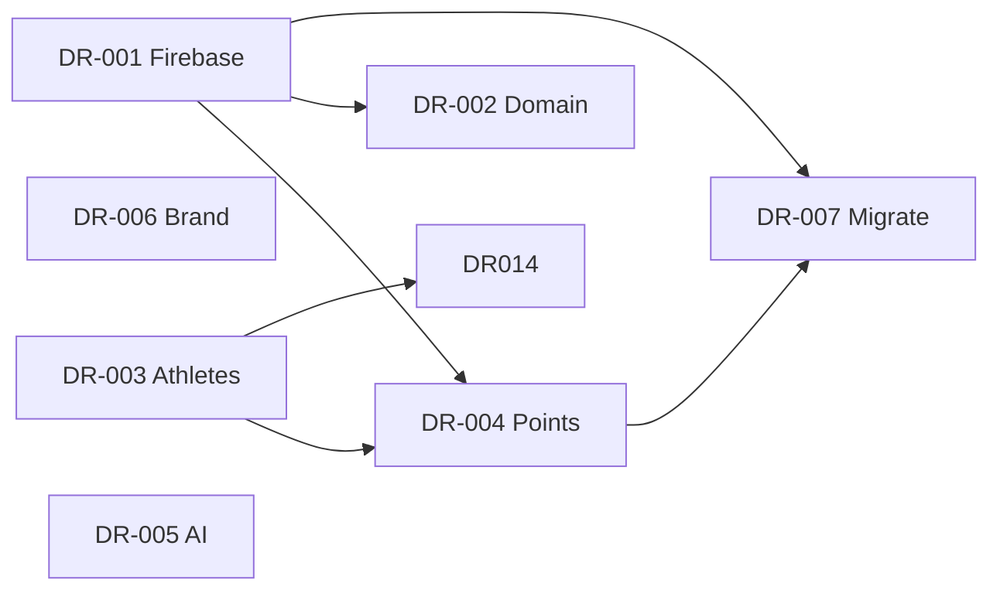

# SkatingX Open Decisions Log

**Document:** Architecture and product decisions required before platform development  
**Version:** 1.0  
**Date:** 2026-06-03  
**Related:** [SKATINGX_ARCHITECTURE_BLUEPRINT.md](./SKATINGX_ARCHITECTURE_BLUEPRINT.md) v2.0 · [merge-readiness-audit.md](./merge-readiness-audit.md)

---

## How to use this log

| Rule | Description |
|------|-------------|
| **No auto-approval** | Nothing in this file is decided until **Status = Approved** and **Decision Owner** is named. |
| **Recommended Option** | Suggested starting point from audits/blueprint only — not a final decision. |
| **Blocking development** | Items marked **Blocking** should be **Approved** before Phase 1 (shell) or as noted per item. |
| **Updates** | Change Status in place; add row to [Change history](#change-history) when approving or rejecting. |

### Status definitions

| Status | Meaning |
|--------|---------|
| **Open** | Not yet discussed or no proposal on the table. |
| **Proposed** | A option is under review; not approved. |
| **Approved** | Decision Owner recorded; implementation may proceed. |
| **Rejected** | Option set ruled out; Notes explain what replaces it. |

---

## Summary tracker

| ID | Topic | Blocking? | Recommended Option | Owner | Status |
|----|-------|-----------|-------------------|-------|--------|
| DR-001 | Production Firebase GCP project | Yes | — | TBD | Open |
| DR-002 | Production domain & URL strategy | Yes | — | TBD | Open |
| DR-003 | Lindsay vs `default` athlete merge | Yes | — | TBD | Open |
| DR-004 | Points (`points`) source of truth | Yes | — | TBD | Open |
| DR-005 | AI Coach LLM vendor & MVP scope | No* | — | TBD | Open |
| DR-006 | Public product brand (BLAZE vs SkatingX) | Yes | — | TBD | Open |
| DR-007 | Legacy data migration strategy | Yes | — | TBD | Open |
| DR-008 | Planning module route placement | No | — | TBD | Open |
| DR-009 | TypeScript adoption for `apps/web` | No | — | TBD | Open |
| DR-010 | Monorepo package manager | No | — | TBD | Open |
| DR-011 | `parentPin` security model | Yes | — | TBD | Open |
| DR-012 | PRO monetization model (MVP) | No | — | TBD | Open |
| DR-013 | Pacing PB sync to training records | No | — | TBD | Open |
| DR-014 | Default `activeAthleteId` after migrate | Yes** | — | TBD | Open |
| DR-015 | Staging / dev Firebase topology | No | — | TBD | Open |

\* Blocks Phase 6 (AI Coach L2) only, not initial shell or Training/Analysis port.  
\*\* Blocks migration cutover for households with both legacy apps on same uid.

---

## Decision records

---

### DR-001 — Production Firebase GCP project

| Field | Value |
|-------|--------|
| **Decision ID** | DR-001 |
| **Topic** | Which Google Cloud / Firebase **production** project SkatingX uses |
| **Blocking** | Yes — blocks env config, migration scripts, Auth domains (Phase 0–1) |

**Options**

| Option | Description |
|--------|-------------|
| **A** | Continue using existing **`blaze-skate-training-platform`** (Training hardcoded project). Import Analysis data from its current project. |
| **B** | Create new project **`skatingx-prod`** (or agreed name). Migrate both Training and Analysis data into it. |
| **C** | Keep **two production projects** temporarily (dual-write / read-fallback). Not recommended as long-term state. |

**Recommended Option (advisory only):** *To be filled after ops review of existing Firebase consoles, billing, and Analysis `VITE_FIREBASE_PROJECT_ID` in Vercel.*

**Decision Owner:** Stephen Lin

**Priority:** Critical

**Status:** Approved 

**Approved Option:** B

**Notes**

- Create a brand-new Firebase project:
  - Project Name: SkatingX
  - Project ID: skatingx-prod (or nearest available equivalent)
- Do not continue long-term development in:
  - blaze-skate-training-platform
  - blaze-skate-analysis production project
- Both legacy applications will become source systems only.
- Future development will occur exclusively in:
  - skatingx-platform
- Training data and Analysis data will be migrated into the new project during the migration phase.
- New writes will use:
  - artifacts/skatingx-production/users/{userId}/...
- Legacy namespaces:
  - blaze-skate-production
  - blaze-skate-academy
  will remain read-only until migration verification is complete.
- This decision supports future:
  - Multi-athlete accounts
  - Coach Portal
  - Club Portal
  - AI Coach
  - SaaS commercialization
- Migration scripts must be completed before production cutover.

---

### DR-002 — Production domain & URL strategy

| Field | Value |
|-------|--------|
| **Decision ID** | DR-002 |
| **Topic** | User-facing **domain(s)** and legacy URL handling |
| **Blocking** | Yes — blocks Vercel config, Auth authorized domains, PWA manifest (before production cutover) |

**Options**

| Option | Description |
|--------|-------------|
| **A** | Single domain e.g. **`app.skatingx.com`** — all routes on one SPA (`/training`, `/analysis`, …). |
| **B** | Subdomains **`training.skatingx.com`** + **`lab.skatingx.com`** (separate deploys or path routing). Conflicts with single-SPA blueprint unless B means path-only branding. |
| **C** | App under path **`skatingx.com/app`** (marketing site separate). |
| **D** | Stay on **Vercel default URLs** until custom domain ready (dev/staging only). |

**Recommended Option (advisory only):** *Blueprint assumes **Option A** (single SPA); confirm domain name and DNS owner.*

**Decision Owner:** Stephen Lin

**Priority:** Critical

**Status:** Approved

**Approved Option:** A  

**Notes**

- Production application domain will be:

  app.skatingx.com

- All platform modules will live under a single React SPA.

Examples:

  /dashboard
  /training
  /analysis
  /athlete
  /coach
  /settings

- Marketing website may later use:

  skatingx.com

- Legacy Blaze Skate Training and Blaze Skate Analysis URLs will eventually redirect to corresponding SkatingX routes.

- Firebase Authentication authorized domains must include:

  app.skatingx.com

- Vercel production deployment will be attached to:

  app.skatingx.com

---

### DR-003 — Lindsay vs `default` athlete merge

| Field | Value |
|-------|--------|
| **Decision ID** | DR-003 |
| **Topic** | How to map legacy profiles when the same `userId` has Training + Analysis data |
| **Blocking** | Yes — blocks migration scripts and `activeAthleteId` (Phase 2+) |

**Options**

| Option | Description |
|--------|-------------|
| **A** | **Two athletes:** `athletes/default` (Training `profile/main`) + `athletes/lindsay` (Analysis `profile/lindsay`). |
| **B** | **Merge into one** athlete document (choose target `athleteId`: `lindsay`, `default`, or new uuid). Field-level merge rules required. |
| **C** | Two athletes but **UI defaults to `lindsay`**; `default` archived or hidden. |

**Recommended Option (advisory only):** *Audit suggests **A** or **C** if Lindsay is the primary real user; **B** if product is strictly single-athlete per account.*

**Decision Owner:** Stephen Lin

**Priority:** High

**Status:** Approved

**Approved Option:** C  

**Notes**

### Approved Decision

Lindsay is the primary athlete for this account.

Training data currently stored under the implicit `default` athlete model
will be migrated into the athlete record:

athletes/lindsay

The legacy `default` athlete will not be displayed in the user interface.

Migration strategy:

1. Import all Training records into `athletes/lindsay`
2. Import all Analysis records into `athletes/lindsay`
3. Preserve original source references during migration
4. Archive legacy `default` athlete data
5. Set:

activeAthleteId = "lindsay"

Future versions may support multiple athletes per account.

---

### DR-004 — Points (`points`) source of truth

| Field | Value |
|-------|--------|
| **Decision ID** | DR-004 |
| **Topic** | Canonical **points balance** when Training and Analysis disagree for the same user/athlete |
| **Blocking** | Yes — blocks migration scripts (Phase 2); wrong choice erodes user trust |

**Options**

| Option | Description |
|--------|-------------|
| **A** | **Analysis-only** for Lindsay athlete: use `profile/lindsay.points`; Training points → backup metadata only. |
| **B** | **Training-only** for default athlete: use `profile/main.points`; Analysis points → backup only. |
| **C** | **Manual alignment** per user/athlete before migrate (spreadsheet sign-off). |
| **D** | **Per-athlete retain** (only if DR-003 = A): `default` gets Training points, `lindsay` gets Analysis points — no single combined balance. |

**Recommended Option (advisory only):** *Do **not** auto-sum** both sources. **C** when same person used both apps; **D** if DR-003 = A.*

**Decision Owner:** Stephen Lin

**Priority:** High

**Status:** Approved

**Approved Option:** B   

**Notes**

- SKATINGX will use Blaze Skate Training as the canonical points source.
- Training points will become the official points balance after migration.
- Analysis points will be preserved in migration backup records only.
- Analysis points will not be added to Training points.
- Analysis check-ins may generate new points in future SKATINGX versions, but historical Analysis points will not be merged into the official balance.
- Target path:
  athletes/{athleteId}/gamification/main.points

Migration Rule

Training:
profile/main.points
→ athletes/{athleteId}/gamification/main.points

Analysis:
profile/lindsay.points
→ migration backup only

Reason:

The Training system contains the primary gamification economy including:
- Daily Tasks
- Streak System
- Reward Shop
- Academy Progression
- Parent Reward Mechanisms

Analysis points are considered secondary engagement metrics and not part of the official economy.
Future Review Date:
After Phase 6 (AI Coach)

---

### DR-005 — AI Coach LLM vendor & MVP scope

| Field | Value |
|-------|--------|
| **Decision ID** | DR-005 |
| **Topic** | Whether **L2 LLM** ships in MVP and which provider |
| **Blocking** | No for Phases 0–5; blocks Phase 6 AI Coach L2 |

**Options**

| Option | Description |
|--------|-------------|
| **A** | **OpenAI** (specify model id in Notes when proposed). |
| **B** | **Anthropic** (specify model). |
| **C** | **Google Gemini** (align with GCP if DR-001 = Google-heavy). |
| **D** | **No L2 in MVP** — ship L0–L1 tags + L3 rule-based recommendations only; add LLM later. |
| **E** | **Other provider** — document in Notes. |

**Deployment sub-options (choose when approving):**

| Sub | Description |
|-----|-------------|
| **FN-1** | Firebase Callable Functions |
| **FN-2** | Vercel Edge Functions |

**Recommended Option (advisory only):** *merge-readiness suggests **D** for initial cutover to limit scope; **FN-1** if L2 required.*

**Decision Owner:** Stephen Lin

**Priority:** High

**Status:** Approved

**Approved Option:** D

**Deployment Option:** N/A

**Notes**

- MVP will not include L2 LLM features.
- Phases 0–5 will use:
  - L0 domain rules
  - L1 analysis tags
  - L3 rule-based training recommendations
- AI Coach V1 will be based on training data, performance records, analysis tags, and knowledge-base rules.
- No external LLM API will be required before Phase 6.
- This reduces development complexity, API costs, and compliance requirements for youth athletes.
- Future AI Coach V2 may evaluate:
  - OpenAI (primary candidate)
  - Google Gemini (secondary candidate)
- If L2 is approved in the future:
  - API keys must never be exposed in client-side code.
  - No raw video or pose landmarks may be sent to LLM services.
  - Free vs PRO usage quotas must be defined.
  - Youth privacy and compliance review must be completed.

---

### DR-006 — Public product brand (BLAZE vs SkatingX)

| Field | Value |
|-------|--------|
| **Decision ID** | DR-006 |
| **Topic** | Customer-facing **brand name** on unified app |
| **Blocking** | Yes — affects copy, domains, store listings, migration comms |

**Options**

| Option | Description |
|--------|-------------|
| **A** | **SkatingX** primary; BLAZE as sub-brand or phased retirement. |
| **B** | **BLAZE** primary; SkatingX as legal/company name only. |
| **C** | **Dual brand** in UI (e.g. “BLAZE powered by SkatingX”) for transition period. |
| **D** | **Regional split** (document locales in Notes). |

**Recommended Option (advisory only):** *Blueprint document title uses **SkatingX**; legacy apps use **BLAZE** — product call required.*

**Decision Owner:** Stephen Lin

**Status:** Approved

**Approved Option:** C  

**Notes**

- Blaze Skate is the primary public-facing brand.
- blazeskate.com remains the primary domain.
- SkatingX becomes the internal platform architecture name.
- Existing products:
  - Blaze Skate Training Platform
  - Blaze Skate Analysis System
  remain part of the Blaze Skate product family.
- Future modules:
  - Blaze Skate AI Coach
  - Blaze Skate Academy
  - Blaze Skate Club
  will use the Blaze Skate brand.
- Firebase, repositories, and technical documentation may continue using the SkatingX platform naming convention.

---

### DR-007 — Legacy data migration strategy

| Field | Value |
|-------|--------|
| **Decision ID** | DR-007 |
| **Topic** | **Cutover pattern** from legacy Firestore paths to `skatingx-production` |
| **Blocking** | Yes — blocks production migration (Phase 7) |

**Options**

| Option | Description |
|--------|-------------|
| **A** | **Big-bang** — maintenance window; batch migrate; switch DNS. |
| **B** | **Beta dual-write** — write new + old paths for N weeks; read new first. |
| **C** | **Read-new only after migrate** — one-time batch; no dual-write. |
| **D** | **New users only on SkatingX** — legacy apps frozen; existing users manual migrate. |

**Recommended Option (advisory only):** *Audit suggests **C** for small user base; **B** if zero-downtime required.*

**Decision Owner:** Stephen Lin

**Status:** Approved

**Approved Option:** C  

**Notes**

- Current user base is extremely small and controlled.
- No requirement for zero-downtime migration.
- Legacy data will be exported before migration.
- Migration will be validated in staging before production cutover.
- After migration, SkatingX becomes the primary platform.
- Legacy Blaze Training and Blaze Analysis remain available in read-only mode for 30 days.
- Firestore exports will be retained for at least 90 days.
- No dual-write architecture will be implemented.
- Rollback strategy: restore Firestore export and temporarily switch users back to legacy apps if validation fails.

---

### DR-008 — Planning module route placement

| Field | Value |
|-------|--------|
| **Decision ID** | DR-008 |
| **Topic** | Where **Junior D weekly plan** (`plansDatabase`) lives in unified IA |
| **Blocking** | No — can default during implementation; affects nav labels |

**Options**

| Option | Description |
|--------|-------------|
| **A** | **`/training/plan`** — planning is part of training workflow (blueprint default). |
| **B** | **`/analysis/planning`** — keep Lab-style grouping under Analysis. |
| **C** | **Both entry points** — same component, two routes. |

**Recommended Option (advisory only):** *Blueprint lists **`/training/plan`** as primary.*

**Decision Owner:** Stephen Lin

**Status:** Approved

**Approved Option:** A  

**Notes**

- Weekly Planning is considered part of the Training workflow.
- Primary route:
  /training/plan

- Analysis modules (Biomechanics, Pacing, Equipment) may create recommendations that link into Training Plan.

- No duplicate route under:
  /analysis/planning

- Future AI Coach recommendations should be applied through:
  /training/plan

- Legacy Analysis tab "planning" will be migrated into Training.

---

### DR-009 — TypeScript adoption for `apps/web`

| Field | Value |
|-------|--------|
| **Decision ID** | DR-009 |
| **Topic** | **TypeScript** for platform codebase |
| **Blocking** | No — should be decided before Phase 1 to avoid rework |

**Options**

| Option | Description |
|--------|-------------|
| **A** | **TypeScript** for `apps/web` + `packages/*` (blueprint implied). |
| **B** | **JavaScript only** for MVP; add TS later. |
| **C** | **TS in packages only**; JS in apps/web initially. |

**Recommended Option (advisory only):** *Blueprint and `packages/schema` assume **A**.*

**Decision Owner:** Stephen Lin

**Priority:** Critical

**Status:** Approved

**Approved Option:** A  

**Notes**

- All new development in `skatingx-platform` will use TypeScript.
- Legacy repositories (`blaze-skate-training`, `blaze-skate-analysis`, `lindii-academy`) remain JavaScript.
- No TypeScript migration will be performed in legacy repositories.
- Feature migration into SkatingX will include TypeScript conversion.
- Shared packages (`schema`, `firebase-client`, `skating-domain`, `content`, `ui`) will be TypeScript-first.
- This decision reduces long-term maintenance risk and improves AI-assisted development quality.

---

### DR-010 — Monorepo package manager

| Field | Value |
|-------|--------|
| **Decision ID** | DR-010 |
| **Topic** | **Package manager** for `skatingx-platform` |
| **Blocking** | No — decide before `pnpm-workspace` / lockfile committed |

**Options**

| Option | Description |
|--------|-------------|
| **A** | **pnpm** workspaces (blueprint example). |
| **B** | **npm** workspaces. |
| **C** | **yarn** Berry workspaces. |

**Recommended Option (advisory only):** *Blueprint examples use **pnpm**.*

**Decision Owner:** Stephen Lin  

**Status:** Approved  

**Approved Option:** A — pnpm workspaces  

**Notes**

- SkatingX is a new platform and should use the package manager best suited for a monorepo structure.
- Use **pnpm workspaces** for `apps/*` and `packages/*`.
- Legacy repos use npm, but they will remain source/reference projects and will not determine the new platform package manager.
- Commit `pnpm-lock.yaml` as the single lockfile for `skatingx-platform`.
- Do not commit `package-lock.json` or `yarn.lock` inside `skatingx-platform`.

---

### DR-011 — `parentPin` security model

| Field | Value |
|-------|--------|
| **Decision ID** | DR-011 |
| **Topic** | How **parent PIN** is stored and validated |
| **Blocking** | Yes — security; before storing PINs in new `settings/main` |

**Options**

| Option | Description |
|--------|-------------|
| **A** | **Hash in Firestore** (bcrypt/argon2); never store plaintext (blueprint target). |
| **B** | **Keep plaintext** temporarily for MVP parity with Training (not recommended). |
| **C** | **No server storage** — PIN hash in device only (loses cross-device). |
| **D** | **Defer parent PIN** to post-MVP; ship without gated settings. |

**Recommended Option (advisory only):** *Training audit flags plaintext risk; blueprint specifies **`parentPinHash`** → **A**.*

**Decision Owner:** Stephen Lin

**Status:** Approved

**Approved Option:** A  

**Notes**

- Parent PIN will never be stored in plaintext.
- Use `parentPinHash` in Firestore.
- Store only bcrypt/argon2 hash.
- Client never receives raw PIN after creation.
- Cross-device support is required.
- Existing Blaze Training plaintext PINs will be migrated to hashed values during data migration.
- Required before public beta.

---

### DR-012 — PRO monetization model (MVP)

| Field | Value |
|-------|--------|
| **Decision ID** | DR-012 |
| **Topic** | How **`isPro`** is granted in unified product |
| **Blocking** | No for dev shell; yes before marketing PRO features |

**Options**

| Option | Description |
|--------|-------------|
| **A** | **Manual** — WeChat + UID copy flow (Training parity); ops updates Firestore. |
| **B** | **Stripe** (or other) — self-serve; custom claims / webhook sets `isPro`. |
| **C** | **Remove PRO from MVP** — all features open for beta. |
| **D** | **Club/org PRO** — defer to SaaS phase (blueprint §13). |

**Recommended Option (advisory only):** *Training production uses **A**; decide if MVP keeps parity.*

**Decision Owner:** Stephen Lin

**Status:** Approved

**Approved Option:** C  

**Notes**

- MVP will not include a paid PRO tier.
- All MVP features will be available to beta users.
- Monetization is deferred until Coach Portal / Club Portal phases.
- Existing Blaze Training PRO features will be migrated as normal features.
- Stripe integration is postponed until post-MVP validation.
- Firestore should still reserve an `isPro` field for future compatibility.

---

### DR-013 — Pacing PB sync to training records

| Field | Value |
|-------|--------|
| **Decision ID** | DR-013 |
| **Topic** | Whether **pacing session results** write to `training/records/{distanceId}` |
| **Blocking** | No |

**Options**

| Option | Description |
|--------|-------------|
| **A** | **Yes** — user can save pacing result as PB entry. |
| **B** | **No** — pacing stays in `analysis/sessions` only. |
| **C** | **Prompted** — suggest save after pacing analysis. |

**Recommended Option (advisory only):** *Blueprint §11 lists optional link; product preference needed.*

**Decision Owner:** Stephen Lin

**Status:** Approved

**Approved Option:** C  

**Notes**

- Pacing analysis results must never automatically overwrite PB records.
- Users may choose to save pacing results into training records.
- Save action should require explicit user confirmation.
- Future versions may support:
  - race video import
  - official timing import
  - coach-approved results
- Saved pacing results should be marked with source metadata:
  pacing-analysis / race-video / manual-entry.
- PB calculations should only use approved record entries.

---

### DR-014 — Default `activeAthleteId` after migrate

| Field | Value |
|-------|--------|
| **Decision ID** | DR-014 |
| **Topic** | **`settings/main.activeAthleteId`** for users with multiple migrated athletes |
| **Blocking** | Yes** — when DR-003 = A or C |

**Options**

| Option | Description |
|--------|-------------|
| **A** | **`lindsay`** for known Lindsay households. |
| **B** | **`default`** for Training-only users. |
| **C** | **Prompt on first login** after migrate. |
| **D** | **Rule-based** — if only one athlete exists, set that id (document rule in Notes). |

**Recommended Option (advisory only):** *Depends on DR-003; **D** + **C** is common pattern.*

**Decision Owner:** Stephen Lin

**Status:** Approved

**Approved Option:** D  

**Notes**

- If only one athlete exists under the account, automatically set activeAthleteId to that athlete.
- If multiple athletes exist, show an athlete selection screen on first login.
- Store the selected athlete in settings/main.activeAthleteId.
- Lindsay migration will automatically resolve to:
  activeAthleteId = "lindsay"
  because only one athlete currently exists.
- This design supports future coach, family, and club accounts without hardcoding athlete names.

---

### DR-015 — Staging / dev Firebase topology

| Field | Value |
|-------|--------|
| **Decision ID** | DR-015 |
| **Topic** | **Non-production** Firebase setup |
| **Blocking** | No — needed before team shared staging |

**Options**

| Option | Description |
|--------|-------------|
| **A** | **Separate Firebase project** per env (`skatingx-dev`, `skatingx-staging`). |
| **B** | **One project** — separate collections or emulator-only local dev. |
| **C** | **Emulator Suite only** for local; single staging project in cloud. |

**Recommended Option (advisory only):** *Avoid dev against production; **A** or **C** typical.*

**Decision Owner:** Stephen Lin

**Status:** Approved

**Approved Option:** C  

**Notes**

- Local development will use Firebase Emulator Suite.
- A dedicated cloud staging project will be created:
  skatingx-staging

- Production will use:
  skatingx-production

- No separate cloud dev project will be created.

- All migration scripts must be tested against Emulator Suite before staging deployment.

- Vercel Preview deployments will point to the staging Firebase project.

- Production data must never be used for development testing.

---

## Pre-development gate checklist

Development **Phase 1 (platform shell)** should not start until these are **Approved**:

- [ ] DR-001  
- [ ] DR-002 (at least staging URL strategy; production domain can follow)  
- [ ] DR-006  
- [ ] DR-009  
- [ ] DR-010  

Migration scripts and production cutover additionally require:

- [ ] DR-003  
- [ ] DR-004  
- [ ] DR-007  
- [ ] DR-011  
- [ ] DR-014 (if multi-athlete migrate)  

AI Coach L2 additionally requires:

- [ ] DR-005  

---

## Suggested decision order

| Order | IDs | Rationale |
|-------|-----|-----------|
| 1 | DR-001, DR-006 | Infrastructure and brand |
| 2 | DR-003, DR-004 | Data model |
| 3 | DR-002, DR-007, DR-014 | Cutover UX |
| 4 | DR-009, DR-010, DR-011, DR-012 | Engineering conventions |
| 5 | DR-008, DR-013, DR-015 | Can parallelize with build |
| 6 | DR-005 | Before AI Coach phase |

---

## Change history

| Date | ID | Change | By |
|------|-----|--------|-----|
| 2026-06-03 | — | Initial decision log created. All items **Open**. No approvals recorded. | — |

---

*Path: `skatingx-platform/docs/SKATINGX_OPEN_DECISIONS.md`*
