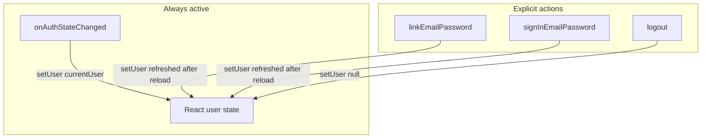

# Auth Debug Report — Anonymous + Email Inconsistency

**Date:** 2026-06-03  
**Reported UI:** `Anonymous = Yes` and `Email = lafa_el@hotmail.com` at the same time  
**Scope:** Read-only review of current implementation (no code changes in this document)

---

## Executive conclusion

| Question | Answer |
|----------|--------|
| Is the UI reading email from the wrong source (form, athlete context, etc.)? | **No** |
| Is the UI mapping logic wrong? | **No** — it displays two fields from the same Firebase `User` object |
| Is auth state incorrect? | **Yes (likely)** — the stored `User` can be **internally inconsistent** (`isAnonymous === true` while `email` is set) |
| Is this a “normal” anonymous user? | **No** — a true anonymous user should have `email == null` |

**Summary:** The screen is a faithful rendering of a **stale or racing Firebase `User` snapshot**, not a separate email field bug. The most probable cause is **`onAuthStateChanged` overwriting a refreshed user** after `linkWithCredential`, leaving `email` updated but `isAnonymous` still `true`.

---

## 1. What the UI shows and where it comes from

### Settings display (`apps/web/src/pages/SettingsPage.tsx`)

| UI field | Source in code | Notes |
|----------|----------------|-------|
| **Status** | `isAnonymous` from context → Guest vs Registered | Derived flag |
| **Anonymous** | `isAnonymous ? "Yes" : "No"` | Same flag |
| **Email** | `user?.email ?? "—"` | **Direct Firebase `User.email`** |
| **UID** | `uid` from context → `user?.uid` | Firebase UID |

```ts
const emailDisplay = user?.email ?? "—";
// ...
isAnonymous ? "Yes" : "No"
```

**Not used for the Email row:**

- Link form state (`bindEmail`) — only bound to the link form inputs
- Sign-in form state (`signInEmail`)
- `ActiveAthleteProvider` / athlete profile
- Firestore or localStorage

**Verdict:** Email on the status card is **only** `user.email` from Firebase Auth.

---

## 2. AuthProvider — user state and mapping

**File:** `apps/web/src/app/providers/AuthProvider.tsx`

### React state

| State | Type | Purpose |
|-------|------|---------|
| `user` | `User \| null` | Single copy of Firebase `User` in React |
| `loading` | `boolean` | Initial auth + logout transitions |
| `authError` | `string \| null` | Last auth operation error |

There is **no separate** `email` or `isAnonymous` cache. Context exposes:

```ts
isAnonymous: user?.isAnonymous ?? true,
uid: user?.uid ?? null,
user,
```

### Default `?? true` behavior

When `user` is `null`, `isAnonymous` becomes `true` (guest assumption).  
When `user` exists, **`isAnonymous` is whatever Firebase puts on that object** — no recomputation from `providerData` or `email`.

**Implication:** If Firebase returns `user.isAnonymous === true` and `user.email === "lafa_el@hotmail.com"`, the UI **will** show exactly the reported inconsistency.

---

## 3. Auth lifecycle — two writers to `user`



### Listener (runs for entire app lifetime)

```ts
subscribeToAuthState(auth, async (currentUser) => {
  if (currentUser) {
    setUser(currentUser);  // no reload()
    setLoading(false);
    return;
  }
  // ... anonymous sign-in if null
});
```

### Link flow

```ts
const refreshed = await linkAnonymousWithEmailPassword(auth, email, password);
setUser(refreshed);  // includes refreshAuthUser() → reload()
```

### Race hypothesis (matches observed symptoms)

| Step | Event | Likely `email` | Likely `isAnonymous` |
|------|--------|----------------|----------------------|
| 1 | Guest session | `null` | `true` |
| 2 | `linkWithCredential` succeeds | may update early | may still `true` |
| 3 | `onAuthStateChanged` fires (same UID) | `lafa_el@hotmail.com` | **`true`** (stale) |
| 4 | Listener `setUser(currentUser)` | set | **overwrites React state** |
| 5 | `refreshAuthUser` + `setUser(refreshed)` | set | `false` |

If step **4** runs **after** step 5, or step 5 fails silently / is slow, the UI can **stick** at step 3:

- **Anonymous = Yes** (`isAnonymous === true`)
- **Email = lafa_el@hotmail.com** (`email` already populated by link)

This matches “email appears but still anonymous” better than “email from wrong source.”

---

## 4. Link account flow (`packages/firebase-client/src/auth.ts`)

### Confirmed: `linkWithCredential` is used

```ts
const credential = EmailAuthProvider.credential(email, password);
await linkWithCredential(currentUser, credential);
return refreshAuthUser(auth);  // reload(currentUser)
```

 Preconditions:

- `auth.currentUser` must exist
- `currentUser.isAnonymous` must be `true` (else throws before link)

### Post-link refresh

`refreshAuthUser`:

1. `reload(auth.currentUser)`
2. Returns `auth.currentUser`

**After a successful link + reload**, Firebase documentation and SDK behavior expect:

- `isAnonymous === false`
- `email` === linked address
- `providerData` includes `providerId: "password"`

If the UI still shows anonymous **after** reload, either:

1. Listener overwrote with pre-reload `currentUser`, or  
2. `reload()` completed but listener delivered an older reference afterward, or  
3. Link did not fully complete server-side (rarer if email is present).

See [auth-link-flow-fix.md](./auth-link-flow-fix.md) for the earlier fix (reload after link). This report explains why inconsistency can **persist** if the listener remains unguarded.

---

## 5. Firebase Auth `User` object — expected vs inconsistent

### True anonymous user (before link)

| Property | Expected |
|----------|----------|
| `isAnonymous` | `true` |
| `email` | `null` / empty |
| `providerData` | `[]` (empty) |

### After successful `linkWithCredential` + `reload`

| Property | Expected |
|----------|----------|
| `isAnonymous` | `false` |
| `email` | linked email |
| `providerData` | includes password provider |

### Reported inconsistent state

| Property | Value |
|----------|--------|
| `isAnonymous` | `true` |
| `email` | `lafa_el@hotmail.com` |

**Not a valid steady-state for a completed link.** It is a known class of **transitional / stale client state**:

- Credential link updates account identifiers (email may appear in token / profile)
- `isAnonymous` on the in-memory `User` may lag until `reload()` or a full auth event with a consistent snapshot
- Firebase issue [#6419](https://github.com/firebase/firebase-js-sdk/issues/6419) discusses `isAnonymous` / `email` not updating atomically in edge cases (unlink scenario); linking can exhibit similar **split-field** updates

---

## 6. Sign-in flow (for comparison)

```ts
await signInWithEmailPassword(auth, email, password);
const refreshed = await refreshAuthUser(auth);
setUser(refreshed);
```

Email/password sign-in typically replaces the session; `isAnonymous` should be `false`. If the user used **Sign in** (not Link) and still sees `Anonymous = Yes`, that would suggest the same listener overwrite or never calling `reload` on the listener path — worth checking in browser DevTools (see §8).

---

## 7. UI logic assessment

| Component | Correct? | Comment |
|-----------|----------|---------|
| Email display | **Yes** | Uses `user.email` only |
| Anonymous display | **Yes** | Uses `isAnonymous` only |
| Status label | **Consistent with flag** | Guest when `isAnonymous` true — **misleading** if email is set |
| Show link form | `isAnonymous && !loading` | Shown while flag true — user could still see link UI **after** email exists (confusing UX) |
| Show logout | `!isAnonymous` | Hidden while flag true — user with email may lack logout button |

**UX issue (not data source bug):** Status / Anonymous / logout gating trust **`isAnonymous` only**, while Email trusts **`email`**. When those diverge on the same object, the page looks contradictory.

**Stronger registered signal (future fix, not applied here):**

```ts
// Example diagnostic — not in codebase today
const hasPasswordProvider = user?.providerData?.some(
  (p) => p.providerId === "password",
);
const isRegistered = Boolean(user?.email && hasPasswordProvider) || !user?.isAnonymous;
```

---

## 8. How to verify in the browser (recommended)

On `/settings`, with DevTools console while reproducing:

```js
// Paste after reproducing Anonymous Yes + email set
const u = firebase?.auth?.()?.currentUser; // if global not exposed, use app hook breakpoint
```

In this app, add a **temporary** log in `AuthProvider` (future debug) or use React DevTools to inspect `user`:

| Check | Command / field |
|-------|------------------|
| `isAnonymous` | `user.isAnonymous` |
| `email` | `user.email` |
| Providers | `user.providerData.map(p => p.providerId)` |
| Same reference as listener | Compare object identity before/after link |

**After link, before manual sign-in:**

- If `providerData` contains `"password"` but `isAnonymous === true` → **SDK / timing inconsistency**; treat as registered for UX; fix listener + reload.
- If `email` set but `providerData` empty → link may not have finished; retry reload.
- If listener fires twice, log order: `setUser` from link vs `onAuthStateChanged`.

Also check Firebase Console → Authentication → Users for the UID: if email is listed and provider is Email/Password, **server state is registered** while **client `isAnonymous` is stale**.

---

## 9. Determination matrix

| Hypothesis | Plausible? | Evidence |
|------------|------------|----------|
| Email from link form leak | **No** | `emailDisplay` only uses `user?.email` |
| Email from athlete context | **No** | No auth imports in athlete provider |
| UI bug (wrong field) | **No** | Straight mapping |
| True anonymous with email | **No** | Contradicts Firebase model for fresh anonymous |
| Stale `User` after link | **Yes** | Matches prior link bug + partial property update |
| `onAuthStateChanged` overwrites refreshed user | **Yes** | Listener calls `setUser(currentUser)` without `reload()` |
| `reload()` not run / failed | **Possible** | Would leave stale `isAnonymous`; less likely if email visible |
| Account actually registered in console | **Check UID** | Client flag wrong, server right |

---

## 10. Recommended fixes (documentation only — not implemented)

Priority order for a follow-up PR:

1. **In `onAuthStateChanged`, reload before `setUser`** when `currentUser` is non-null (or debounce listener updates during `linkEmailPassword`).
2. **Derive “registered” for UI** from `providerData` + `email`, not `isAnonymous` alone.
3. **After link/sign-in**, ignore the next listener callback or compare `user.metadata.lastSignInTime` / provider count before overwriting.
4. **Settings debug row (dev only):** show `providerData` provider IDs to surface split state.
5. **Sign-in path:** return `refreshAuthUser` from `signInWithEmailPassword` internally (already called in provider).

---

## 11. Files reviewed

| File | Role |
|------|------|
| `apps/web/src/app/providers/AuthProvider.tsx` | Auth state, listener, link/sign-in/logout |
| `apps/web/src/pages/SettingsPage.tsx` | User-facing status |
| `packages/firebase-client/src/auth.ts` | `linkWithCredential`, `reload`, sign-in/out |
| `docs/auth-link-flow-fix.md` | Prior link + reload fix |

---

## 12. Related documents

- [implementation-audit-m1-auth.md](./implementation-audit-m1-auth.md)
- [auth-link-flow-fix.md](./auth-link-flow-fix.md)
- [SKATINGX_ARCHITECTURE_BLUEPRINT.md](./SKATINGX_ARCHITECTURE_BLUEPRINT.md) — Auth expectations
