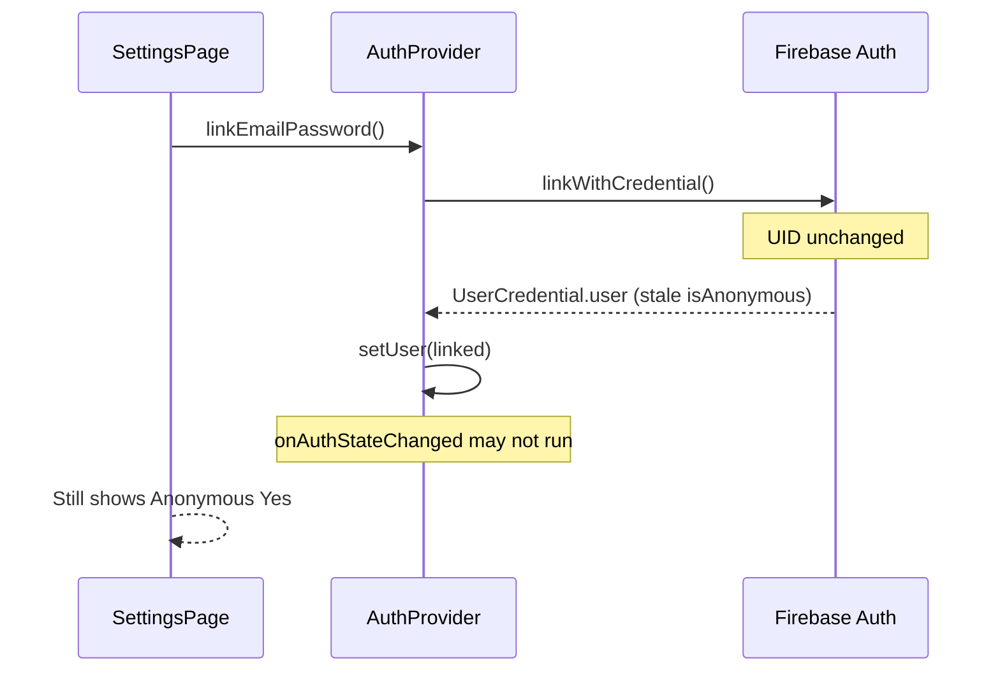

# Auth Link Flow — Audit & Fix

**Date:** 2026-06-03  
**Symptom:** After “Link account”, Settings still showed `Anonymous = Yes` until a separate email/password sign-in.  
**Status:** Fixed in `@skatingx/firebase-client` + `AuthProvider`.

---

## Expected vs observed

| Field | Expected after successful link | Observed (before fix) |
|-------|-------------------------------|------------------------|
| `isAnonymous` | `false` | `true` |
| `email` | Linked address | empty / missing |
| Status label | Registered account | Guest (anonymous) |

---

## Verification checklist

### 1. Is `linkWithCredential()` actually being used?

**Yes.**

`packages/firebase-client/src/auth.ts` → `linkAnonymousWithEmailPassword()`:

```ts
const credential = EmailAuthProvider.credential(email, password);
await linkWithCredential(currentUser, credential);
```

This matches the legacy Training app (`blaze-skate-training` `App.jsx`).

### 2. Is `currentUser` refreshed after linking?

**Before fix: No (not reliably).**

- `AuthProvider.linkEmailPassword` called `setUser(linked)` with `result.user` from `linkWithCredential`.
- Firebase often keeps the **same in-memory `User` instance** for the same UID; `isAnonymous` and `email` can stay stale until `reload()`.
- `onAuthStateChanged` **does not always fire** when anonymous is linked to email/password, because the **UID unchanged** — only provider data changes.

**After fix: Yes.**

- `linkAnonymousWithEmailPassword` calls `refreshAuthUser(auth)` → `reload(auth.currentUser)`.
- `AuthProvider` then `setUser(refreshed)` from `auth.currentUser` after reload.

### 3. Is `isAnonymous` cached in state?

**Partially — derived from React state, but state held a stale `User` object.**

```ts
isAnonymous: user?.isAnonymous ?? true,
```

Not a separate boolean cache. The bug was **`user` not updated** with post-link fields, not a wrong derived flag.

Default `?? true` when `user` is null is correct for logged-out edge cases.

### 4. Why did sign-in “fix” the UI?

`signInWithEmailAndPassword` creates a **new auth session**; `onAuthStateChanged` fires and/or returned user already has updated `isAnonymous` and `email`. That masked the missing `reload()` after link.

---

## Root cause



---

## Fix implemented

### `packages/firebase-client/src/auth.ts`

| Change | Purpose |
|--------|---------|
| `refreshAuthUser(auth)` | `reload(currentUser)` then return `auth.currentUser` |
| `linkAnonymousWithEmailPassword` | After `linkWithCredential`, call `refreshAuthUser` instead of returning credential user as-is |

### `apps/web/src/app/providers/AuthProvider.tsx`

| Change | Purpose |
|--------|---------|
| After successful link | `refreshAuthUser` + `setUser(refreshed)` + `setLoading(false)` |
| After email sign-in | Same refresh pattern for consistent UI |

No extra sign-in step required after link.

---

## Post-fix expected UI (immediate)

After successful “Link account”:

- **Anonymous:** No  
- **Email:** Linked address  
- **Status:** Registered account  
- Link form hidden (`isAnonymous === false`)  
- Sign out button visible  

---

## Manual test

1. Start as guest on `/settings` — Anonymous Yes, UID visible.  
2. Link new email + password (≥ 6 chars).  
3. Without signing in again, confirm Anonymous **No**, email shown, status **Registered account**.  
4. Sign out → new guest UID.  
5. Optional: link email already in use → error, sign-in form still works.

---

## Build verification

```bash
npm run build
```

Must exit 0 (run after applying this fix).

---

## Related

- [implementation-audit-m1-auth.md](./implementation-audit-m1-auth.md)
- Firebase: [Link anonymous auth to email/password](https://firebase.google.com/docs/auth/web/anonymous-auth#convert-an-anonymous-account-to-a-permanent-account)
