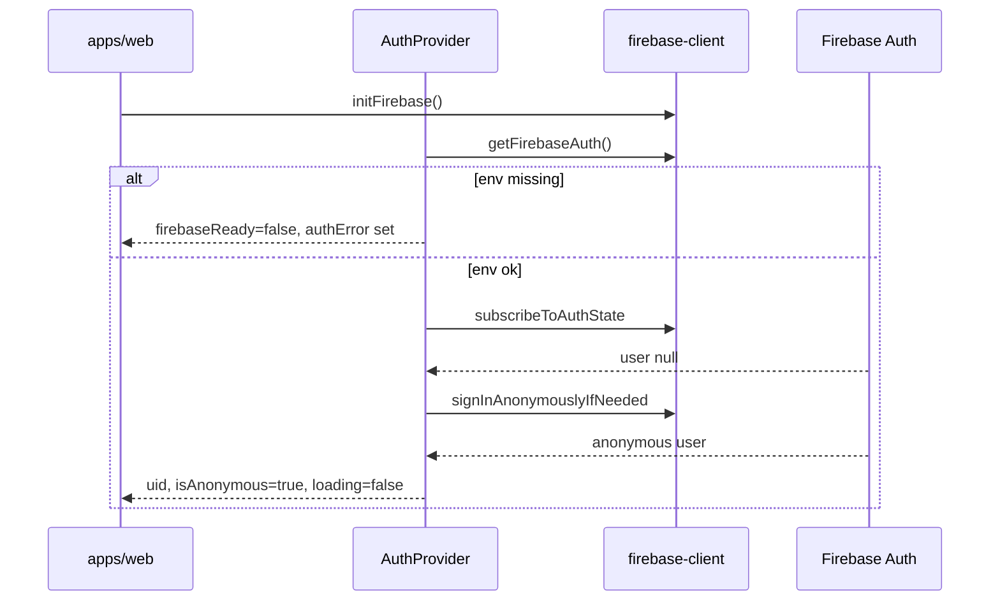

# Implementation Audit — M1 Auth Foundation

**Repository:** `skatingx-platform`  
**Audit date:** 2026-06-03  
**Scope:** Firebase initialization + Firebase Auth (no Firestore, no legacy feature ports)  
**Prior:** [implementation-audit-m0.md](./implementation-audit-m0.md), [PHASE-1-VALIDATION.md](./PHASE-1-VALIDATION.md)

---

## Executive summary

M1 adds a **Firebase Auth layer** in `@skatingx/firebase-client` and an **`AuthProvider`** in `apps/web`, with a **Settings** UI for guest status, account linking, sign-in, and sign-out. Behavior follows the legacy Training app pattern (anonymous first, email link, email sign-in, logout → new guest).

| Goal | Status |
|------|--------|
| Firebase init via `VITE_FIREBASE_*` | Done |
| `AuthProvider` | Done |
| Anonymous login on load | Done |
| Email/password link (anonymous → registered) | Done |
| Email/password sign-in | Done |
| Logout | Done |
| Expose user, uid, isAnonymous, loading, authError | Done |
| Settings UI | Done |
| `.env.example` | Present (root) |
| No Firestore profile | Confirmed — not added |
| No athlete migration | Confirmed — unchanged placeholder roster |

**Build:** `npm run build` — **PASS** (2026-06-03).

---

## 1. What was added

### 1.1 `packages/firebase-client`

| File | Purpose |
|------|---------|
| `src/app.ts` | `initFirebase()`, `getFirebaseApp()` (split from monolithic `index`) |
| `src/auth.ts` | Auth SDK wrappers + `getAuthErrorMessage()` |
| `src/config.ts` | Unchanged — env read + completeness check |
| `src/index.ts` | Re-exports app + auth API |

**Public auth API:**

| Export | Behavior |
|--------|----------|
| `getFirebaseAuth()` | Returns `Auth` after app init, or `null` if env incomplete |
| `subscribeToAuthState(auth, listener)` | `onAuthStateChanged` wrapper |
| `signInAnonymouslyIfNeeded(auth)` | `signInAnonymously` |
| `linkAnonymousWithEmailPassword(auth, email, password)` | `EmailAuthProvider` + `linkWithCredential` |
| `signInWithEmailPassword(auth, email, password)` | `signInWithEmailAndPassword` |
| `signOutUser(auth)` | `signOut` |
| `getAuthErrorMessage(error)` | User-facing messages for common `auth/*` codes |
| `User` | Re-exported Firebase `User` type |

**SDK:** `firebase` ^11.6.1 (Auth from `firebase/auth`).

### 1.2 `apps/web`

| File | Purpose |
|------|---------|
| `src/app/providers/AuthProvider.tsx` | Context: `user`, `uid`, `isAnonymous`, `loading`, `authError`, `firebaseReady`, auth actions |
| `src/pages/SettingsPage.tsx` | Account status, bind form, sign-in form, logout |
| `src/main.tsx` | `initFirebase()` → `AuthProvider` → `ActiveAthleteProvider` → `App` |

**Hook:** `useAuth()` — must be used inside `AuthProvider`.

### 1.3 `packages/ui`

| Change | Reason |
|--------|--------|
| `Button` accepts `type="submit"` | Settings forms |

### 1.4 Root tooling

| Change | Purpose |
|--------|---------|
| `package.json` `typecheck` | Includes `@skatingx/firebase-client` |
| `firebase-client/package.json` | `"typecheck"` script |

---

## 2. Auth flow



### Anonymous on load

1. `onAuthStateChanged` fires.
2. If `currentUser` exists → set user, `loading = false`.
3. If `null` → `signInAnonymously` (guarded against duplicate in-flight calls).
4. Next auth event sets the anonymous user.

### Link email/password

- Only shown when `isAnonymous && firebaseReady`.
- Requires password length ≥ 6 (client-side).
- Uses `linkWithCredential` on current anonymous user.
- `auth/email-already-in-use` → message directing user to sign-in form.

### Sign in (existing account)

- `signInWithEmailAndPassword` replaces session (same as legacy warning).
- Available whenever Firebase is ready (including while guest).

### Logout

- Confirm dialog.
- `signOut` → auth state `null` → provider signs in **new** anonymous user automatically.
- Logout button shown only for **non-anonymous** users.

---

## 3. Settings UI (`/settings`)

| Section | Content |
|---------|---------|
| Current user | Status label, full UID, anonymous flag, email |
| Error banner | `authError` from provider |
| Link email & password | Guest only — email + password + submit |
| Sign in to existing account | Email + password + submit |
| Sign out | Registered users only |
| Guest hint | First 8 chars of UID |

**Not implemented (by design):** parent PIN, PRO, theme, language, Firestore-backed profile.

---

## 4. Provider stack

```text
BrowserRouter
└── AuthProvider          ← M1
    └── ActiveAthleteProvider   ← still in-memory; no Firestore
        └── App / routes
```

`ActiveAthleteProvider` is **independent** of Auth UID (athlete migration deferred).

---

## 5. Environment

**File:** `.env.example` (repository root)

```env
VITE_FIREBASE_API_KEY=
VITE_FIREBASE_AUTH_DOMAIN=
VITE_FIREBASE_PROJECT_ID=
VITE_FIREBASE_STORAGE_BUCKET=
VITE_FIREBASE_MESSAGING_SENDER_ID=
VITE_FIREBASE_APP_ID=
```

**Local setup:** copy to `apps/web/.env.local` (Vite loads env from the app directory).

**Degraded mode:** If any required key is missing, `initFirebase()` returns `null`, `AuthProvider` sets `firebaseReady: false` and a configuration message — app still renders.

**Firebase console:** Enable **Anonymous** and **Email/Password** providers for the target project.

---

## 6. Explicit non-goals (verified)

| Item | Status |
|------|--------|
| Firestore `settings/main` or `profile/main` reads/writes | Not implemented |
| `userId` → athlete path wiring | Not implemented |
| Legacy `blaze-skate-training` / `blaze-skate-analysis` code changes | None |
| Training/Analysis feature ports | None |
| IndexedDB persistence (`enableIndexedDbPersistence`) | Not implemented |
| Custom token / embed auth | Not implemented |
| `VITE_PLATFORM_APP_ID` | Not implemented |

---

## 7. Blueprint / M1 alignment

| Blueprint expectation | M1 state |
|----------------------|----------|
| `initFirebase()` from env | Done |
| Anonymous auth | Done |
| Email link on anonymous user | Done |
| Email sign-in | Done |
| Sign out | Done |
| Auth in `providers/` | `AuthProvider` added |
| `/settings/account` route | **Not split** — auth UI on `/settings` index (acceptable for M1) |
| Firestore repositories | Deferred |
| Firebase SDK ^12 | Still on ^11.6.1 |

---

## 8. Build and TypeScript

```bash
npm run typecheck   # schema + firebase-client + web
npm run build       # tsc --noEmit && vite build
```

| Metric | Value |
|--------|--------|
| Vite modules | 85 (was 78 pre-M1) |
| Main JS bundle | ~424 kB (~115 kB gzip) — includes Firebase Auth |

---

## 9. Manual test checklist

- [ ] With valid `.env.local`, open `/settings` — guest UID appears after brief loading
- [ ] Link new email/password — `isAnonymous` becomes false, email shown
- [ ] Sign out — returns to guest with **new** UID
- [ ] Sign in with existing credentials — session switches to that account
- [ ] Link with already-registered email — error points to sign-in form
- [ ] Without env — configuration error shown, no crash

---

## 10. Recommended next steps (M2+)

1. **Firestore:** `settings/main` (`User`) + `athletes/{id}/profile/main` read/write keyed by `auth.uid`.
2. Persist `activeAthleteId` from `User` document instead of only local placeholder state.
3. Enable Auth persistence policy explicitly if needed (default browser persistence applies).
4. Split `/settings/account` route when settings grow (PIN, PRO).
5. Align Firebase SDK to v12 when upgrading dependencies.

---

## Related documents

- [SKATINGX_ARCHITECTURE_BLUEPRINT.md](./SKATINGX_ARCHITECTURE_BLUEPRINT.md) — §4 Firebase, §8 `firebase-client`
- [implementation-audit-m0.md](./implementation-audit-m0.md)
- [SKATINGX_OPEN_DECISIONS.md](./SKATINGX_OPEN_DECISIONS.md) — DR-001 Firebase project
