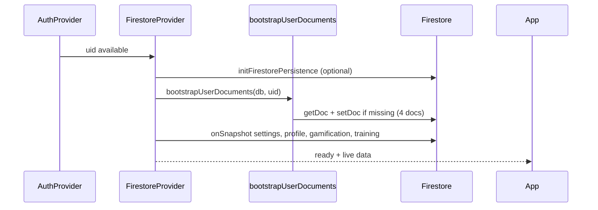

# Implementation Audit — M2 Firestore + Athlete Profile

**Date:** 2026-06-03  
**Scope:** Firestore path helpers, default document bootstrap, real-time hooks, Dashboard + Athlete UI  
**Prerequisites:** M0 skeleton, M1 Auth ([implementation-audit-m1-auth.md](./implementation-audit-m1-auth.md))

---

## Executive summary

M2 wires **Firestore** under `artifacts/skatingx-production/users/{userId}/` with idempotent default documents for **Lindsay**, real-time subscriptions, and UI that reads live data on Dashboard and Athlete pages.

| Goal | Status |
|------|--------|
| Path helpers | Done — `@skatingx/schema` + `@skatingx/firebase-client` refs |
| Default docs after login | Done — `bootstrapUserDocuments` on auth UID |
| Default athlete Lindsay | Done |
| Hooks (5) | Done — via `FirestoreProvider` |
| Athlete + Dashboard UI | Done |
| Loading / error states | Done |
| Offline persistence | Attempted — graceful skip on multi-tab / unsupported |
| Legacy migration | **Not done** (by design) |
| Task edit / records / analysis | **Not done** (by design) |

**Build:** `npm run typecheck` + `npm run build` — **PASS**

---

## 1. Firestore schema (target tree)

```text
artifacts/skatingx-production/users/{userId}/
├── settings/main
└── athletes/{athleteId}/
    ├── profile/main
    ├── gamification/main
    └── trainingState/main
```

Valid document paths (8 segments each under `users/{userId}`):

| Document | Path suffix |
|----------|-------------|
| Settings | `settings/main` |
| Profile | `athletes/{athleteId}/profile/main` |
| Gamification | `athletes/{athleteId}/gamification/main` |
| Training state | `athletes/{athleteId}/trainingState/main` |

**Not** `training/state/main` — that path has 9 segments and Firestore rejects it.

### 1.1 `settings/main` (`UserSettings`)

| Field | Default (new user) |
|-------|-------------------|
| `activeAthleteId` | `"lindsay"` |
| `language` | `"zh"` |
| `theme` | `"system"` |
| `createdAt` | `serverTimestamp()` on create |
| `updatedAt` | `serverTimestamp()` on create |

### 1.2 `athletes/lindsay/profile/main` (`AthleteProfile`)

| Field | Default |
|-------|---------|
| `athleteId` | `"lindsay"` |
| `displayName` | `"Lindsay Lin"` (UI label: Name) |
| `birthDate` | `"2015-01-14"` |
| `sport` | `"short_track_speed_skating"` |
| `country` | `"USA"` |
| `createdAt` / `updatedAt` | server timestamps on create |

### 1.3 `athletes/lindsay/gamification/main` (`Gamification`)

| Field | Default |
|-------|---------|
| `points` | `0` |
| `streakDays` | `0` |
| `completedDays` | `[]` |
| `updatedAt` | server timestamp on create |

### 1.4 `athletes/lindsay/trainingState/main` (`TrainingState`)

Firestore document paths must have an **even** number of segments (`collection/document/...`). The earlier path `training/state/main` (9 segments) was invalid; `trainingState/main` (8 segments) is correct.

| Field | Default |
|-------|---------|
| `todayTasks` | `[]` |
| `weeklyTemplate` | `{ monday..sunday: "" }` |
| `lastLoginDate` | today `YYYY-MM-DD` (client date at bootstrap) |
| `updatedAt` | server timestamp on create |

---

## 2. Package layout

### `@skatingx/schema`

| Module | Purpose |
|--------|---------|
| `paths.ts` | String paths + `pathToSegments()` |
| `constants.ts` | `PLATFORM_APP_ID`, `DEFAULT_ATHLETE_ID` |
| `defaults.ts` | `createDefault*` factories |
| `user.ts` | `UserSettings` |
| `athlete.ts` | `AthleteProfile` |
| `gamification.ts` | `Gamification` (M2 fields) |
| `training.ts` | `TrainingState`, `WeeklyTemplateByDay` |

### `@skatingx/firebase-client`

| Module | Purpose |
|--------|---------|
| `firestore/db.ts` | `getFirestoreDb()` |
| `firestore/refs.ts` | DocumentReference builders |
| `firestore/bootstrap.ts` | `bootstrapUserDocuments(userId)` |
| `firestore/subscribe.ts` | `subscribeToDocument` |
| `firestore/persistence.ts` | `initFirestorePersistence` |

---

## 3. Hooks

Implemented in `apps/web/src/app/providers/FirestoreProvider.tsx`, re-exported from `apps/web/src/hooks/firestore/index.ts`.

| Hook | Returns |
|------|---------|
| `useUserSettings()` | `{ data, loading, error }` for `UserSettings` |
| `useAthleteProfile()` | `{ data, loading, error }` for `AthleteProfile` |
| `useGamification()` | `{ data, loading, error }` for `Gamification` |
| `useTrainingState()` | `{ data, loading, error }` for `TrainingState` |
| `useActiveAthlete()` | `{ athleteId, profile, loading, error }` — `athleteId` from settings |

Also: `useFirestoreStatus()` — bootstrap ready, `connectivityError` (bootstrap or listener failures only).

**Provider stack:**

```text
AuthProvider → FirestoreProvider → App
```

Replaces in-memory `activeAthleteContext` (removed).

---

## 4. Default document creation flow



### Idempotency

- Each doc: `getDoc` → create only if **missing**.
- Existing documents are **not** overwritten (safe for repeat visits).

### Security rules (assumption)

Client writes assume rules allow:

```text
match /artifacts/skatingx-production/users/{userId}/{document=**}
  allow read, write: if request.auth.uid == userId;
```

Rules file not added in M2 — deploy separately (see M0 audit gaps).

---

## 5. UI changes

### Dashboard (`/dashboard`)

- Stat cards: athlete name, points, streak days, today’s task count
- `FirestoreStatusBanner` — loading / connectivity error (no persistence dev notes)
- Per-slice error banner

### Athlete (`/athlete`)

- Name, birth date, sport, country
- Active athlete ID (from settings)
- Account UID (from auth)
- `AthleteSelector` reads Firestore profile (single athlete M2)

### Removed

- Placeholder `activeAthleteContext` roster (`demo-skater` UI only in memory — not in Firestore M2)

---

## 6. Offline persistence

**Implementation:** `enableIndexedDbPersistence(db)` once per session.

| Outcome | Behavior |
|---------|----------|
| Success | Offline read cache enabled |
| `failed-precondition` | Another tab has persistence — app continues online; **console.info only** |
| `unimplemented` | Browser unsupported — continues without cache; **console.info only** |
| Other errors | Logged with **console.warn**; app continues without cache |

Persistence skips are **not** shown in `FirestoreStatusBanner`. Users only see banners for real connectivity problems (bootstrap failure or Firestore listener errors via `connectivityError`).

**Why safe:** Does not alter auth flow; persistence failures never block reads/writes in the active tab.

---

## 7. Assumptions and limitations

| Topic | Assumption |
|-------|------------|
| **App ID** | `skatingx-production` (`PLATFORM_APP_ID`) |
| **Single athlete** | Only `lindsay` bootstrapped; subscriptions fixed to `DEFAULT_ATHLETE_ID` |
| **activeAthleteId** | Stored in settings but switching athletes does not re-subscribe yet |
| **Timestamps** | Firestore `Timestamp` in DB; UI treats dates as strings where typed |
| **Streak** | `streakDays` is stored; not auto-calculated from `completedDays` yet |
| **Tasks** | `todayTasks` read-only count on dashboard — no CRUD |
| **Legacy data** | No import from Training/Analysis projects |
| **Name field** | Stored as `displayName` per schema (UI shows “Name”) |

---

## 8. Out of scope (confirmed)

- Task editing, records, analysis sessions
- Multi-athlete create/switch persistence
- Firestore security rules / indexes in repo
- `firebase/` deploy config
- Gamification points rules / rollover

---

## 9. Manual testing checklist

### Prerequisites

- [ ] `apps/web/.env.local` with valid `VITE_FIREBASE_*`
- [ ] Firebase Auth: Anonymous + Email/Password enabled
- [ ] Firestore rules allow authenticated user read/write under their `users/{uid}` path

### Bootstrap (new anonymous user)

- [ ] Sign in as guest → open `/dashboard` → “Loading your data…” then content
- [ ] Firebase Console → `artifacts/skatingx-production/users/{uid}/settings/main` exists
- [ ] `athletes/lindsay/profile/main`, `gamification/main`, `trainingState/main` exist
- [ ] Profile fields match Lindsay defaults
- [ ] `gamification.points === 0`, `streakDays === 0`
- [ ] `training.state.todayTasks === []`

### UI

- [ ] Dashboard shows name **Lindsay Lin**, points **0**, streak **0 days**, tasks **0**
- [ ] `/athlete` shows sport, country, birth date, active athlete **lindsay**, UID matches auth
- [ ] Refresh page — data persists (same UID)
- [ ] Second visit — bootstrap does not reset existing docs (points unchanged if manually edited in console)

### Errors

- [ ] Break rules (deny write) → error banner on Dashboard/Athlete
- [ ] Missing env → auth/firestore degraded message (no crash)

### Persistence (optional)

- [ ] Open app in two tabs → no UI banner; console shows `[skatingx/firestore] Offline cache skipped…`; app still works
- [ ] Single tab → offline cache enabled (no banner)
- [ ] Break Firestore rules or network → red connectivity banner on Dashboard/Training pages

---

## 10. Files added / changed (reference)

| Area | Key files |
|------|-----------|
| Schema | `packages/schema/src/*` (types, defaults, paths) |
| Firebase | `packages/firebase-client/src/firestore/*` |
| Provider | `apps/web/src/app/providers/FirestoreProvider.tsx` |
| Hooks | `apps/web/src/hooks/firestore/index.ts` |
| UI | `DashboardPage`, `AthletePage`, `FirestoreStatusBanner`, `AthleteSelector` |
| Entry | `apps/web/src/main.tsx` |

---

## Related

- [SKATINGX_ARCHITECTURE_BLUEPRINT.md](./SKATINGX_ARCHITECTURE_BLUEPRINT.md) — §5 Firestore Schema
- [implementation-audit-m0.md](./implementation-audit-m0.md)
- [implementation-audit-m1-auth.md](./implementation-audit-m1-auth.md)
