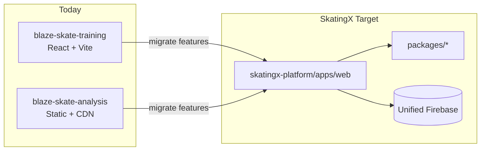

# Merge Readiness Audit: blaze-skate-training × blaze-skate-analysis

**Document:** Comparative merge readiness report  
**Date:** 2026-06-03  
**Target architecture:** [SKATINGX_ARCHITECTURE_BLUEPRINT.md](./SKATINGX_ARCHITECTURE_BLUEPRINT.md) **v2.0**  
**Sources:**

- [blaze-skate-training/docs/architecture-audit.md](../../blaze-skate-training/docs/architecture-audit.md)
- [blaze-skate-analysis/docs/architecture-audit.md](../../blaze-skate-analysis/docs/architecture-audit.md)
- [SKATINGX_ARCHITECTURE_BLUEPRINT.md](./SKATINGX_ARCHITECTURE_BLUEPRINT.md) — **v2.0**
- [SKATINGX_OPEN_DECISIONS.md](./SKATINGX_OPEN_DECISIONS.md) — open decisions (to be maintained)

**Constraint:** No changes were made to `blaze-skate-training` or `blaze-skate-analysis` application code.

---

## 1. Executive Summary

| Dimension | Finding |
|-----------|---------|
| **Merge feasibility** | **Conditionally feasible (~55/100)** — product domains align; engineering stacks do not |
| **Recommended approach** | **Platform migration (Option B)** into `skatingx-platform` monorepo — not git-merge of repos or side-by-side nav only |
| **Combined codebase size** | ~7,400 lines in two monoliths (`App.jsx` 3,834 + `index.html` 3,570) |
| **Shared code today** | **Zero** npm packages, imports, or Firestore namespaces |
| **Primary blockers** | Different Firebase projects/config; different `appId`; incompatible data shapes; Firebase SDK 12 vs 11; React vs vanilla CDN |
| **Primary enablers** | Same `artifacts/{appId}/users/{uid}` pattern; overlapping domains (points, 500m/777m/1000m, Junior D plans vs Academy); both production-ready |

**Verdict:** Merging is a **re-platforming exercise** with a defined schema and phased migration. A naive union of repositories or a single deploy without data migration will split user data and duplicate points.



---

## 2. Direct Merge Feasibility

### What “direct merge” would mean

| Interpretation | Feasible? | Outcome |
|----------------|-----------|---------|
| **Git merge** two repos into one folder without refactor | Technically yes | Unmaintainable: two entry points, two Firebase inits, no shared UI |
| **Single SPA** wrapping both apps via iframes/links | Yes (short term) | Does **not** unify data; two `appId` trees; two point balances |
| **Single SPA** copying both monoliths into one file | No (advised against) | ~7.4k+ lines; React + DOM scripts conflict |
| **Platform migration** to `skatingx-platform/apps/web` | **Yes (recommended)** | One router, one SDK, one schema; preserves domain logic via extraction |

### Feasibility matrix

| Criterion | Training | Analysis | Unified without migration? |
|-----------|----------|----------|----------------------------|
| Same Auth UID can access both datasets | Possible if same GCP project | Possible | **No** — different paths & projects today |
| Same points balance | `profile/main.points` | `profile/lindsay.points` | **No** — duplicate counters |
| Same task model | `tasks[]` in blob | `completedTasks/{id}` | **No** |
| Same deploy pipeline | Undefined in repo | Vercel | Must be designed |
| Same UI framework | React 19 | Vanilla | **Must rewrite** Analysis to React or isolate |

**Direct merge readiness score: 2/10** (code) · **8/10** (product fit)

---

## 3. Technology Stack Differences

| Layer | blaze-skate-training | blaze-skate-analysis | Unified target |
|-------|------------------------|----------------------|----------------|
| **UI** | React 19 | HTML + vanilla JS | React 19 |
| **Build** | Vite 8 (full app bundle) | None (static); build = Firebase config only | Vite 8 monorepo |
| **CSS** | Tailwind 3 (PostCSS) | Tailwind CDN + inline CSS | Tailwind 3 build |
| **Icons** | lucide-react | Font Awesome 6 | lucide-react (or shared ui kit) |
| **Charts** | Inline SVG | Chart.js CDN | Chart.js npm or shared wrapper |
| **ML** | None | MediaPipe Pose CDN | `@mediapipe/pose` lazy chunk |
| **Firebase SDK** | npm `firebase ^12.13.0` | CDN `firebasejs/11.6.1` | npm `firebase ^12.x` |
| **State** | React `useState` / `useEffect` | `window.*` globals | React Context + hooks |
| **Router** | `activeTab` state | `switchTab()` | React Router 7 |
| **TypeScript** | No | No | Recommended in platform |
| **Tests** | None | None | Vitest (critical paths) |
| **CI** | None | None | GitHub Actions |
| **Lint** | ESLint 10 | None | ESLint shared config |
| **Config** | Hardcoded in `App.jsx` | `VITE_FIREBASE_*` at build | Env for all |
| **Offline Firestore** | IndexedDB persistence enabled | Not enabled | Enable platform-wide |
| **Deploy** | Not defined in repo | Vercel static root | Vercel `apps/web` |

---

## 4. Firebase / Firestore Schema Differences

### Configuration

| Aspect | Training | Analysis |
|--------|----------|----------|
| **GCP project (known)** | `blaze-skate-training-platform` (hardcoded) | From Vercel env (not in repo) |
| **Logical `appId`** | `blaze-skate-production` | `blaze-skate-academy` (default) |
| **Config delivery** | Source code | Generated `firebase-config.js` |
| **Rules in repo** | No | Yes (`firestore.rules`) |
| **Storage SDK** | Unused | Unused |

### Path comparison (same `uid`, different trees)

```text
TRAINING:
  artifacts/blaze-skate-production/users/{uid}/profile/main     ← single document (entire app state)

ANALYSIS:
  artifacts/blaze-skate-academy/users/{uid}/profile/lindsay     ← athlete profile + points
  artifacts/blaze-skate-academy/users/{uid}/completedTasks/{id}   ← planning check-ins
  artifacts/blaze-skate-academy/users/{uid}/equipmentRecords/{id}
```

### Data model contrast

| Domain | Training (`profile/main`) | Analysis |
|--------|---------------------------|----------|
| **Athlete** | Implicit (username only) | Fixed `lindsay` doc + `birthDate` |
| **Points** | Field on blob; client arithmetic on task toggle | `increment` in transaction + profile field |
| **Daily tasks** | `tasks[]` + `taskHistory{}` | N/A (uses plan cards) |
| **Plan tasks** | Academy import → `tasks[]` | `plansDatabase` + `completedTasks` |
| **PB records** | `records`, `records777`, … | Pacing UI only (not persisted) |
| **Equipment** | None | `equipmentRecords` subcollection |
| **Biomechanics** | None | Session-only `keyframeSamples` |
| **Account settings** | language, theme, parentPin, isPro on blob | Theme local only; no email bind |
| **Avatar** | JPEG data URL in Firestore | N/A |
| **Races / shop** | `races[]`, `customRewards`, `rewardHistory` | N/A |

### Write-pattern contrast

| Pattern | Training | Analysis |
|---------|----------|----------|
| Reads | `onSnapshot` one doc | `onSnapshot` profile + 2 collections |
| Writes | `setDoc` merge whole blob | `setDoc`, `addDoc`, `runTransaction` |
| Idempotency | Client-side task ids | Transaction guards duplicate `completedTasks` |
| Timestamps | ISO strings in app data | `serverTimestamp()` on tasks/equipment |

### Known Analysis bug (migration must fix)

Equipment listener uses `orderBy('createdAt')` but cloud writes set `savedAt` — sort order may be wrong after merge.

---

## 5. Authentication Differences

| Capability | Training | Analysis | Unified requirement |
|------------|----------|----------|---------------------|
| Default sign-in | `signInAnonymously` | `signInAnonymously` | Keep |
| Email/password bind | `linkWithCredential` | No UI | Keep (family accounts) |
| Sign in existing email | `signInWithEmailAndPassword` | No | Keep |
| Sign out | `signOut` + full reload | Not emphasized | Consistent UX |
| Custom token | No | `signInWithCustomToken` | Keep for coach/embed |
| Auth domain | Training Firebase project | Analysis env project | **Single project** (DR-001) |

**Merge implication:** Unified app Auth must support **anonymous + email link + custom token** without forcing Analysis users through email UI.

---

## 6. Routing Differences

### Today (no URLs)

| App | Nav | Tabs |
|-----|-----|------|
| **Training** | Bottom bar (5) | `dashboard`, `tasks`, `academy`, `data`, `shop` |
| **Analysis** | Top tabs (4) | `biomechanics`, `pacing`, `planning`, `equipment` |

Secondary surfaces: Training uses **modals** (profile, auth, records, races, shop admin); Analysis uses **in-tab panels** and cross-tab functions (`goToPlanningAndLoad`).

### Target SkatingX routes (from blueprint v2.0, §6)

| Legacy | Unified path |
|--------|----------------|
| Training dashboard | `/dashboard` |
| tasks / academy / shop | `/training`, `/training/tasks`, `/training/academy`, `/training/shop` |
| data | `/training/records` |
| Analysis planning | `/training/plan` or `/analysis/planning` |
| biomechanics / pacing / equipment | `/analysis/biomechanics`, `/analysis/pacing`, `/analysis/equipment` |
| — | `/athlete`, `/ai-coach`, `/settings` |

**Gap:** Neither app supports deep links today; merge must introduce React Router and redirects from old deploy URLs if any.

---

## 7. UI / UX Differences

| Aspect | Training | Analysis |
|--------|----------|----------|
| **Visual tone** | Light, family-friendly themes (purple/blue/green/…) | Dark lab default; light mode added |
| **Language** | zh + en (UI + Academy) | zh-CN primary |
| **Layout** | `max-w-md` mobile shell, bottom nav | Wide grid layouts, top tabs |
| **Persona** | Generic skater / guest | Lindsay-specific badge, division calc |
| **PRO** | Manual WeChat unlock, parent PIN | N/A |
| **Gamification** | Shop, streaks, daily bonus | Points on plan check-in only |
| **Privacy messaging** | Cloud sync loading | Explicit “video never uploaded” |
| **Default landing** | Dashboard (after load) | Biomechanics tab active |

**UX merge strategy:** Single `AppShell` with mode-aware **Analysis layout** (darker) vs **Training layout** (lighter), shared design tokens in `packages/ui`; avoid forcing one theme on both flows.

---

## 8. Data Migration Risks

| Risk | Severity | Detail | Mitigation |
|------|----------|--------|------------|
| **Two Firebase projects** | Blocker | Training vs Analysis production may differ | DR-001: pick one GCP project; export both |
| **Two `appId` namespaces** | Blocker | Data isolated under different paths | Migrate to `skatingx-production` |
| **Points double-count** | Blocker | Two balances per uid | DR-004: pick truth source; never auto-sum |
| **Profile blob split** | High | Training fields scattered across many target docs | Scripted split per blueprint v2.0 §15 |
| **Lindsay vs default athlete** | High | Same uid may have both | DR-003: merge or dual `athleteId` |
| **Avatar data URL size** | Medium | Large `profile/main` docs | Move to Storage on migrate |
| **`parentPin` plaintext** | Medium | Security debt carries forward | Hash at migrate or in new settings |
| **Equipment sort field** | Medium | `createdAt` vs `savedAt` | Normalize on write during migrate |
| **Pacing/biomechanics loss** | Low | Not in Firestore today | Accept; optional `analysisSessions` going forward |
| **localStorage keys** | Low | `blaze_lang` vs `blaze-theme-mode` | One-time copy to `skatingx_*` prefixes |
| **Anonymous uid change** | Low | New anonymous after Training logout | Communicate; email bind preserves data |

---

## 9. Recommended Unified Architecture

**Pattern:** Single React SPA (`skatingx-platform/apps/web`) + shared packages + one Firebase project.

```mermaid
flowchart TB
  subgraph client [apps/web]
    R[React Router]
    R --> DASH[/dashboard]
    R --> TR[/training/*]
    R --> AN[/analysis/*]
    R --> ATH[/athlete]
    R --> COACH[/ai-coach]
    R --> SET[/settings]
  end

  subgraph packages [packages]
    SCH[schema]
    DOM[skating-domain]
    FB[firebase-client]
    CNT[content]
    UI[ui]
  end

  subgraph edge [Browser]
    MP[MediaPipe chunk]
  end

  client --> packages
  AN --> MP
  client --> Firebase[(Auth + Firestore + Storage avatars)]
  COACH --> FN[Callable AI L2 optional]
```

**Principles (from blueprint v2.0, §1 & §4–5):**

1. One `platformAppId`: `skatingx-production`
2. Athlete-centric paths: `athletes/{athleteId}/...`
3. Video stays client-side; persist `analysisSessions` summaries + `analysisTag[]` only
4. Tags drive recommendations → optional AI Coach → user confirms task writes

---

## 10. Recommended SkatingX Folder Structure

```
skatingx-platform/
├── apps/
│   └── web/                         # Unified SPA
│       └── src/
│           ├── app/router.tsx
│           ├── features/
│           │   ├── dashboard/
│           │   ├── training/          # from blaze-skate-training
│           │   ├── analysis/          # from blaze-skate-analysis
│           │   ├── athlete/
│           │   ├── ai-coach/
│           │   └── settings/
│           └── layouts/
├── packages/
│   ├── schema/
│   ├── skating-domain/              # time parse, age division, pace/bio rules
│   ├── firebase-client/
│   ├── content/                       # academy.json, plans-junior-d.json
│   └── ui/
├── firebase/
│   ├── firestore.rules
│   └── firestore.indexes.json
├── scripts/migrate/
│   ├── training-to-skatingx.ts
│   ├── analysis-to-skatingx.ts
│   └── verify-migration.ts
└── docs/
    ├── merge-readiness-audit.md       # this file
    ├── SKATINGX_ARCHITECTURE_BLUEPRINT.md   # v2.0
    ├── SKATINGX_OPEN_DECISIONS.md
    ├── MERGE_READINESS_AUDIT_SKATINGX.md
    └── merge-readiness-audit.md
```

**Legacy repos:** Remain read-only archives; no ongoing feature development on monoliths post-cutover.

---

## 11. Recommended Firebase Schema

**Root pattern:**

```text
artifacts/skatingx-production/users/{userId}/
├── settings/main
├── athletes/{athleteId}/
│   ├── profile/main
│   ├── gamification/main
│   ├── training/state/main
│   ├── training/taskHistory/{dateId}
│   ├── training/records/{distanceId}
│   ├── training/races/{raceId}
│   ├── training/rewards/catalog
│   ├── training/redemptions/{id}
│   ├── planning/completedTasks/{taskId}
│   ├── equipment/records/{recordId}
│   ├── analysis/sessions/{sessionId}/summary
│   └── coach/recommendations/{recId}
└── meta/migration
```

### Mapping from legacy paths

| Legacy | Target |
|--------|--------|
| Training `.../profile/main` (whole doc) | Split → `settings/main` + `athletes/default/*` |
| Analysis `.../profile/lindsay` | `athletes/lindsay/profile/main` + `gamification/main` |
| Analysis `completedTasks/*` | `athletes/lindsay/planning/completedTasks/*` |
| Analysis `equipmentRecords/*` | `athletes/lindsay/equipment/records/*` |

**Security rules:** Extend Analysis rule template to require `appId == 'skatingx-production'`; deploy from `firebase/` in platform repo.

---

## 12. Feature Migration Order

| Phase | Features | Source | Depends on |
|-------|----------|--------|------------|
| **M0** | Platform bootstrap, CI, env, rules | New | DR-001 |
| **M1** | Auth (anonymous + email + custom token) | Both | M0 |
| **M2** | `settings`, `athleteId`, athlete profile | Training + Analysis | M1 |
| **M3** | Dashboard shell | New + Training widgets | M2 |
| **M4** | Tasks, taskHistory, rollover | Training | M2, data migrate partial |
| **M5** | Records / timing utilities | Training | M4 |
| **M6** | Academy + shop + PRO + parent PIN | Training | M4 |
| **M7** | Planning / `plansDatabase` + transactional check-in | Analysis | M2, gamification |
| **M8** | Equipment records + rules | Analysis | M2, fix timestamp fields |
| **M9** | Pacing (Chart.js) | Analysis | M5 (optional link to records) |
| **M10** | Biomechanics (MediaPipe lazy) | Analysis | M9 optional |
| **M11** | `analysisSessions` + tags persistence | New + Analysis heuristics | M10 |
| **M12** | AI Coach L1–L3 | New | M11 |
| **M13** | Data cutover + decommission legacy deploys | Ops | All above |

**Rule:** Training data migration (M4–M6) before Analysis athlete-dependent paths (M7–M8) when same uid maps to `lindsay` + `default`.

---

## 13. What Should Be Reused

| Asset | From | Reuse how |
|-------|------|-----------|
| **Domain logic** | Training | `formatTimeInput`, `parseTimeToSeconds`, `getRecordsKey`, cross-day rollover, `toggleTask` points rules → `packages/skating-domain` |
| **Domain logic** | Analysis | `calculateSkatingAge`, `getUSSpeedskatingDivision`, support-leg scoring, pacing decay index, `buildEquipmentRuleHints` → `packages/skating-domain` |
| **Content** | Training | `BLAZE_ACADEMY` → `packages/content/academy.json` |
| **Content** | Analysis | `plansDatabase` → `packages/content/plans-junior-d.json` (editorial merge with Academy) |
| **i18n** | Training | `translations` → message catalog (extend for Analysis strings) |
| **Themes** | Training | `THEMES` token maps → `packages/ui` |
| **Firestore rules pattern** | Analysis | Base for `firebase/firestore.rules` |
| **Env config pipeline** | Analysis | `VITE_FIREBASE_*` + generate script → `apps/web` |
| **Auth flows** | Training | Email link + sign-in; add Analysis custom token |
| **Check-in transaction** | Analysis | Idempotent `completedTasks` + `increment` → `firebase-client` |
| **UX patterns** | Both | Lindsay division badge, equipment compare, academy import matching |
| **Vercel deploy model** | Analysis | Static/build pattern adapted to Vite output |

---

## 14. What Should Be Rewritten

| Item | Reason |
|------|--------|
| **Analysis `index.html` monolith** | Port to React components + Vite; eliminate `window.*` globals |
| **CDN dependencies** | Pin npm versions (Firebase 12, Chart.js, MediaPipe) |
| **Training `App.jsx` monolith** | Split into `features/training/*`; not copy-paste |
| **Routing** | Replace `activeTab` / `switchTab` with React Router |
| **Firestore writes** | Replace blob `setDoc` with repository per subdocument |
| **Avatar storage** | Storage URLs instead of Firestore data URLs |
| **`parentPin` handling** | Hash or server-side guard; not plaintext |
| **Dual Firebase init** | Single `packages/firebase-client` |
| **Hardcoded Training Firebase config** | Environment variables |
| **Equipment Firestore query** | Align `createdAt` / `savedAt` |
| **Default athlete model** | Replace `profile/lindsay` hard-code with `activeAthleteId` |
| **AI Coach** | New module (not in either repo) |
| **Analysis session persistence** | New `analysis/sessions` (optional keyframes policy) |
| **CI/tests** | New pipelines; no tests to port |

**Do not rewrite from scratch:** pacing formulas, support-leg heuristics, task points economics, or Academy/plan content — **extract and test** instead.

---

## 15. Risk Level and Mitigation Plan

### Overall risk: **Medium–High** (controlled by phasing)

| ID | Risk | Level | Mitigation |
|----|------|-------|------------|
| R1 | Data loss on migration | High | GCloud export; batch scripts; `meta/migration` checksums; verify script |
| R2 | Wrong points after merge | High | DR-004; manual alignment table; backup fields |
| R3 | Regression in 7.4k lines of untested logic | High | Extract pure functions + Vitest; manual test checklist per phase |
| R4 | MediaPipe bundle breaks mobile | Medium | Lazy route; performance budget; fallback message |
| R5 | Firebase project mismatch in prod | High | DR-001 before any migrate script |
| R6 | User confusion (two athletes) | Medium | DR-003; clear athlete switcher UX |
| R7 | CDN outage (current Analysis) | Medium | Eliminated after npm bundle |
| R8 | Scope creep (AI Coach) | Medium | Ship M0–M10 without L2 LLM; DR-005 |
| R9 | Legacy deploy still writing old paths | Medium | Beta dual-write then read-new-only; read-only legacy banner |
| R10 | Security rules drift | Medium | Single `firebase/` source; deploy in CI |

### Rollback plan

1. Keep legacy deploys available for 30–90 days post-cutover.
2. Store pre-migration exports and `pointsBackup` on `meta/migration`.
3. If verify script fails >1% users, halt cutover and revert DNS to legacy apps.

---

## 16. Step-by-step Merge Roadmap

### Phase 0 — Decisions & backup (1–2 weeks)

- [ ] Complete [SKATINGX_OPEN_DECISIONS.md](./SKATINGX_OPEN_DECISIONS.md) DR-001 through DR-005
- [ ] Export Firestore: Training project + Analysis project
- [ ] Inventory production URLs (Vercel, any Training host)
- [ ] Freeze feature work on monoliths except P0 hotfixes

### Phase 1 — Platform shell (1–2 weeks)

- [ ] Initialize `skatingx-platform` git repo; pnpm workspaces
- [ ] `apps/web`: Vite + React 19 + React Router + Tailwind
- [ ] Routes: `/dashboard`, `/training`, `/analysis`, `/settings` (placeholders)
- [ ] `packages/firebase-client`: init from `VITE_FIREBASE_*`
- [ ] `firebase/firestore.rules` deployed to target project
- [ ] CI: lint + build

### Phase 2 — Schema & migration scripts (2–3 weeks)

- [ ] `packages/schema`: paths, types, Zod validators
- [ ] `scripts/migrate/training-to-skatingx.ts`
- [ ] `scripts/migrate/analysis-to-skatingx.ts`
- [ ] `scripts/migrate/verify-migration.ts`
- [ ] Dry-run on staging Firebase

### Phase 3 — Training module (3–4 weeks)

- [ ] Port Auth (anonymous, email bind, logout)
- [ ] Port tasks, rollover, taskHistory, dashboard
- [ ] Port records + time utilities
- [ ] Port academy, shop, PRO, settings, themes
- [ ] Point reads/writes to `athletes/{id}/gamification`
- [ ] Beta: dual-write or migrate Training users (DR-001 project)

### Phase 4 — Analysis module (3–5 weeks)

- [ ] Port planning + `checkTask` transaction
- [ ] Port equipment + fix timestamp indexing
- [ ] Port pacing + Chart.js
- [ ] Port biomechanics + MediaPipe lazy route
- [ ] Migrate Analysis Firestore data to `athletes/lindsay` (per DR-003)
- [ ] Lindsay division badge → `athletes/lindsay/profile`

### Phase 5 — Unify & connect (2–3 weeks)

- [ ] Single `activeAthleteId` in `settings/main`
- [ ] Dashboard: tasks + latest analysis tags
- [ ] Persist `analysis/sessions` + `analysisTag` generation (L1)
- [ ] Optional: write pacing PBs to `training/records` (product decision)
- [ ] localStorage key migration

### Phase 6 — AI Coach & polish (2–4 weeks, optional)

- [ ] `coach/recommendations` + apply-to-tasks (L3)
- [ ] LLM Callable if DR-005 approves (L2)
- [ ] i18n pass for Analysis strings
- [ ] PWA assets fix (logos, manifest)

### Phase 7 — Cutover (1 week)

- [ ] Production migrate scripts (maintenance window or background batch)
- [ ] Point verification sign-off (DR-004)
- [ ] DNS/Vercel → unified `apps/web`
- [ ] Legacy apps: read-only + redirect message
- [ ] Monitor Firestore errors, Auth anomalies, bundle size

### Phase 8 — Cleanup (ongoing)

- [ ] Archive `blaze-skate` and `blaze-skate-analysis` tags `pre-skatingx`
- [ ] Remove dual-write
- [ ] Delete legacy `artifacts/blaze-skate-*` paths after retention period
- [ ] Update workspace docs; onboard contributors to monorepo

---

## Appendix A: Side-by-side feature matrix

| Feature | Training | Analysis | Unified owner |
|---------|----------|----------|---------------|
| Daily tasks | Yes | No | Training |
| Task history calendar | Yes | No | Training |
| BLAZE Academy (age bands) | Yes | No | Training |
| Junior D weekly plans | No | Yes | Training/plan route |
| Plan check-in + points tx | No | Yes | Shared gamification |
| PB records | Yes | No | Training |
| Pacing decay analysis | No | Yes | Analysis |
| MediaPipe biomechanics | No | Yes | Analysis |
| Equipment records | No | Yes | Analysis |
| Points shop | Yes | No | Training |
| Parent PIN / PRO | Yes | No | Settings |
| Email account bind | Yes | No | Settings |
| Custom token auth | No | Yes | Auth provider |
| US division badge | No | Yes | Athlete profile |
| Firestore offline | Yes | No | Platform |

## Appendix B: Document lineage

| Document | Role |
|----------|------|
| Per-repo `architecture-audit.md` | Evidence base for this comparison |
| `MERGE_READINESS_AUDIT_SKATINGX.md` | Workspace-wide first audit |
| [SKATINGX_ARCHITECTURE_BLUEPRINT.md](./SKATINGX_ARCHITECTURE_BLUEPRINT.md) | **Target-state architecture (v2.0)** — product vision, modules, schema, migration |
| [SKATINGX_OPEN_DECISIONS.md](./SKATINGX_OPEN_DECISIONS.md) | Product/infra decisions (DR-001–DR-005, etc.) |
| `merge-readiness-audit.md` (this file) | **Synthesized merge plan from both audits**; defers to blueprint **v2.0** for target design |

### Blueprint v2.0 section index (for cross-reference)

| Topic in this audit | Blueprint v2.0 section |
|---------------------|-------------------------|
| §9 Unified architecture | §1 Product Vision, §4 Firebase |
| §10 Folder structure | §7 Folder Structure, §8 Shared Packages |
| §11 Firebase schema | §5 Firestore Schema |
| §12 Feature migration order | §10 Training, §11 Analysis, §15 Migration |
| §9 AI Coach | §9 AI Coach Architecture |
| Curriculum / plans | §12 Knowledge Base Module |
| SaaS later | §13 Future SaaS Expansion |
| Deploy | §14 Deployment Architecture |

---

*Path: `skatingx-platform/docs/merge-readiness-audit.md`*
